# INFORME DE LABORATORIO

| | |
|---|---|
| **DEPARTAMENTO:** | Ciencias de la Computación |
| **CARRERA:** | Ingeniería en Sistemas / Software |
| **ASIGNATURA:** | Aplicaciones Distribuidas |
| **NIVEL:** | 7mo Semestre |
| **FECHA:** | 27 de octubre de 2026 |
| **DOCENTE:** | [Nombre del Docente] |
| **PRÁCTICA N°:** | Laboratorio WebSockets |
| **CALIFICACIÓN:** | |

---

# Aplicación de Comunicación Persistente y Mensajería Grupal en Tiempo Real con WebSockets

**Estudiante(s):** [Nombres y Apellidos del Estudiante]

---

## RESUMEN

En el presente laboratorio se diseñó e implementó una aplicación web de mensajería grupal en tiempo real fundamentada en el protocolo de comunicación persistente WebSocket (RFC 6455) utilizando la biblioteca Socket.IO sobre un servidor construido en Node.js y Express. La arquitectura implementada permite que múltiples usuarios se conecten simultáneamente desde distintos navegadores o terminales, se identifiquen formalmente a través de un modal obligatorio y mantengan una comunicación bidireccional inmediata sin requerir la actualización manual de la página ni consultas repetitivas bajo el modelo HTTP Polling. El código fue estructurado bajo estrictos principios de separación de responsabilidades y modularidad, segregando la capa de red del servidor, los servicios de dominio en memoria, los manejadores de eventos WebSocket, y los módulos del cliente divididos en transporte de red, renderizado de interfaz y orquestación. Adicionalmente, se incorporaron nueve retos funcionales avanzados que incluyen indicador dinámico de tipeo, confirmación visual de entrega, reacciones interactivas con emojis, eliminación lógica de mensajes, respuesta citada contextual, filtrado en tiempo real, fijado de avisos prioritarios, estados de presencia y resiliencia con reconexión automática ante interrupciones del servidor. El sistema fue validado en entornos locales y expuesto a Internet mediante un túnel seguro para corroborar su interoperabilidad desde un dispositivo móvil en red celular externa, demostrando empíricamente las ventajas de WebSocket en eficiencia de red y latencia.

**Palabras Claves:** WebSocket, Socket.IO, Comunicación Persistente

---

## 1. INTRODUCCIÓN

Las arquitecturas orientadas a la web han dependido históricamente del protocolo de transferencia de hipertexto (HTTP), cuyo modelo de intercambio se basa estrictamente en el paradigma solicitud-respuesta (*request-response*). Si bien este esquema es idóneo para la entrega de documentos estáticos y consumo de APIs transaccionales, presenta serias deficiencias al intentar resolver las exigencias de interactividad inmediata que demandan los sistemas colaborativos contemporáneos. Las soluciones iniciales como *Polling* y *Long-Polling* emulan la reactividad obligando al cliente a realizar peticiones periódicas al servidor; sin embargo, este enfoque introduce una sobrecarga considerable de cabeceras redundantes (cookies, metadatos HTTP) y desperdicia recursos computacionales procesando respuestas vacías.

El protocolo **WebSocket (RFC 6455)** transforma esta dinámica al proporcionar un canal de comunicación dúplex completo (*full-duplex*) y persistente sobre una única conexión de transporte TCP. Mediante un apretón de manos inicial (*HTTP Upgrade Handshake*), el canal se transforma en un enlace permanente a través del cual tanto el cliente como el servidor tienen la capacidad de emitir tramas de datos de manera proactiva e independiente en cualquier instante de tiempo, reduciendo las cabeceras a apenas 2 a 10 bytes por paquete.

El presente trabajo práctico aborda de manera integral el desarrollo de una aplicación distribuida de chat grupal en tiempo real. La práctica no se restringe únicamente al diseño de una interfaz visual atractiva, sino que profundiza en la disciplina técnica requerida para gestionar el ciclo de vida de los sockets, administrar el estado temporal de presencia de múltiples clientes, propagar eventos concurrentes de mensajería y edición, garantizar resiliencia ante cortes abruptos del servicio y verificar la operatividad del sistema en condiciones reales de red pública a través de túneles seguros.

---

## 2. OBJETIVO(S)

### 2.1. Describir los alcances o metas de la práctica o experimento

#### 2.1.1. Objetivo General
Diseñar, implementar y evaluar una aplicación web distribuida de mensajería grupal en tiempo real empleando comunicación persistente basada en WebSockets con Node.js, Express y Socket.IO, aplicando principios de arquitectura modular, gestión dinámica de eventos y validación en entornos locales y remotos.

#### 2.1.2. Objetivos Específicos
- Establecer un canal persistente y bidireccional entre múltiples clientes y el servidor central, sustituyendo de forma efectiva el paradigma de sondeo HTTP periódico.
- Diseñar e implementar un esquema de eventos WebSocket semánticos y específicos para el registro de usuarios, difusión de mensajes, sincronización de ediciones y control de presencia.
- Estructurar el proyecto de forma modular garantizando la separación de responsabilidades entre el servidor web, los controladores de eventos de red, los servicios de lógica de negocio y los componentes de interfaz en el cliente.
- Desarrollar un conjunto superior a cinco retos técnicos adicionales (logrando nueve en total) que enriquezcan la experiencia en tiempo real, tales como indicadores de escritura, reacciones con emojis, citas de mensajes, estados de presencia y fijado de elementos.
- Analizar el comportamiento del sistema distribuido ante la pérdida de conectividad física del servidor y validar la respuesta del mecanismo de reconexión automática con *backoff* exponencial.
- Exponer el servidor local a Internet mediante un túnel seguro (ngrok / Cloudflare) para verificar el cruce de barreras NAT y la comunicación exitosa desde clientes externos en redes de datos móviles.

---

## 3. MARCO TEÓRICO

### 3.1. Protocolo WebSocket y RFC 6455
El estándar RFC 6455 define al protocolo WebSocket como una tecnología que facilita la apertura de una sesión de comunicación bidireccional interactiva entre el navegador del usuario y un servidor. Su operación inicia sobre el puerto HTTP estándar (80 o 443) mediante una solicitud regular con cabeceras especiales:
```http
GET /socket.io/?EIO=4&transport=websocket HTTP/1.1
Host: localhost:3000
Upgrade: websocket
Connection: Upgrade
Sec-WebSocket-Key: dGhlIHNhbXBsZSBub25jZQ==
Sec-WebSocket-Version: 13
```
Si el servidor admite el protocolo, responde con un código de estado `101 Switching Protocols`, completando el *handshake*. A partir de ese momento, la capa TCP queda abierta para transferir tramas de datos (*data frames*) que pueden ser de texto (codificadas en UTF-8) o binarias, suprimiendo la necesidad de renegociar cabeceras HTTP en cada mensaje.

### 3.2. Biblioteca Socket.IO y Abstracción de Red
Socket.IO es una capa de abstracción construida sobre WebSockets que añade robustez empresarial a las comunicaciones en tiempo real. Entre sus capacidades fundamentales se encuentran:
1. **Fallback Automático:** Si el entorno de red de un cliente intermedio bloquea el protocolo WebSocket (por ejemplo, proxies corporativos restrictivos), Socket.IO degrada transparentemente el transporte a *HTTP Long-Polling*.
2. **Reconexión Automática con Backoff:** Administra la reconexión automática configurando intervalos de reintento progresivos para evitar sobrecargar al servidor cuando este se reinicia.
3. **Multiplexación y Salas (*Rooms*):** Permite canalizar eventos hacia subconjuntos de clientes o salas específicas sin alterar el enlace socket primario.
4. **Acuses de Recibo (*Acknowledgements*):** Habilita callbacks en el emisor que se ejecutan cuando el receptor procesa exitosamente un evento transmitido.

### 3.3. Modelo Push vs. Modelo Pull
- **Modelo Pull (Sondeo HTTP):** El cliente consulta al servidor periódicamente (`GET /messages`). Genera alta latencia (la mitad del intervalo de muestreo en promedio) y congestiona el ancho de banda debido a la sobrecarga de cabeceras HTTP en respuestas redundantes o vacías.
- **Modelo Push (WebSocket):** El servidor empuja (*pushes*) los datos hacia los clientes suscritos en el instante exacto en que ocurre el evento de negocio. Elimina las consultas innecesarias y reduce la latencia al mínimo que impone el tiempo de ida y vuelta (*Round-Trip Time*, RTT) de la red física.

### 3.4. Traducción de Direcciones de Red (NAT) y Túneles Inversos
En despliegues domésticos y conexiones celulares, los dispositivos se ubican detrás de puertas de enlace con *Network Address Translation* (NAT) y cortafuegos que impiden que clientes externos originen conexiones directas hacia direcciones IP privadas (ej: `192.168.1.x`). Las herramientas de túnel inverso como **ngrok** resuelven este impedimento al iniciar una conexión de salida persistente contra un servidor relay en la nube. Este servidor relay provee un nombre de dominio público seguro (`https://...ngrok-free.app`) que enruta cualquier tráfico entrante de vuelta por el túnel hacia el puerto local especificado, posibilitando pruebas en redes públicas sin apertura manual de puertos en el enrutador físico.

---

## 4. DESCRIPCIÓN DEL PROCEDIMIENTO

### 4.1. Materiales, Muestras y Métodos Utilizados
- **Materiales de Hardware:** Estación de trabajo anfitriona con procesador multinúcleo x86_64, memoria RAM de 16 GB, conexión de red local WiFi/Ethernet y teléfono inteligente Android conectado a red celular 4G LTE para pruebas de cliente remoto.
- **Software y Entornos:**
  - Node.js v22.21.0 (Runtime de JavaScript en el servidor)
  - npm v10.x (Gestor de paquetes de Node.js)
  - Express.js v5.3.0 (Servidor web y ruteo estático)
  - Socket.IO v4.8.4 (Motor de comunicación WebSocket bidireccional)
  - Google Chrome v130+ y Microsoft Edge (Navegadores web para validación multiventana)
  - ngrok v3 (Herramienta de túnel inverso para pruebas en Internet pública)
- **Métodos y Enfoque:** Implementación modular basada en el patrón de arquitectura por capas, desarrollo dirigido por eventos (*Event-Driven Architecture*) y validación de software mediante scripts de automatización con Puppeteer para la generación de evidencias bajo condiciones controladas.

---

### 4.2. Estructura y Arquitectura Modular del Proyecto

La aplicación se diseñó de forma desacoplada respetando la separación estricta de responsabilidades entre el servidor, los servicios de dominio, los eventos de transporte y los módulos de usuario:

```text
websocket-counter-class/
│
├── server/                               # CAPA DE SERVIDOR Y NEGOCIO DISTRIBUIDO
│   ├── server.js                         # Inicialización HTTP, Express y Socket.IO
│   │
│   ├── services/                         # MODELO DE DOMINIO Y GESTIÓN DE ESTADO EN MEMORIA
│   │   ├── userService.js                # Gestión de usuarios, presencia y paleta de colores
│   │   └── chatService.js                # Historial de mensajes, autoría, edición, borrado, reacciones
│   │
│   └── socket/                           # MANEJADORES MODULARES DE EVENTOS WEBSOCKET
│       ├── connectionHandler.js          # Ciclo de vida: conexiones, desconexiones y distribución
│       ├── userHandler.js                # Eventos de entrada (join), estado de presencia y typing
│       └── messageHandler.js             # Eventos de mensajería, edición, eliminación, reacción y pin
│
├── public/                               # CLIENTE WEB MODULAR (FRONTEND NATIVO)
│   ├── index.html                        # Estructura semántica HTML5, modales y layout del chat
│   │
│   ├── css/
│   │   └── style.css                     # Sistema de diseño Glassmorphism, animaciones y responsive
│   │
│   └── js/
│       ├── socket.js                     # Capa de transporte y encapsulamiento Socket.IO cliente
│       ├── ui.js                         # Renderizado del DOM, manipulación de vistas y notificaciones
│       └── app.js                        # Orquestador principal de eventos y flujos de usuario
│
├── docs/                                 # DOCUMENTACIÓN Y EVIDENCIAS
│   └── evidencias/                       # Capturas de pantalla en formato PNG
│
├── scripts/                              # AUTOMATIZACIÓN DE PRUEBAS
│   ├── capture_all_evidences.js          # Captura de evidencias generales del sistema
│   └── capture_individual_retos.js       # Captura de evidencias de los retos implementados
│
├── package.json                          # Manifiesto de dependencias y scripts de ejecución
├── README.md                             # Guía técnica de instalación y puesta en marcha
└── INFORME_LABORATORIO.md                # Informe técnico formal del laboratorio
```

---

### 4.3. Comandos de Instalación, Ejecución y Exposición

#### 4.3.1. Instalación de Dependencias
```bash
# Ingresar al directorio del proyecto
cd "websocket-counter-class"

# Instalar los paquetes definidos en package.json
npm install
```

#### 4.3.2. Ejecución del Servidor
```bash
# Iniciar en modo estándar
npm start

# O iniciar en modo desarrollo con supervisión de cambios
npm run dev
```

#### 4.3.3. Comprobación del Endpoint de Diagnóstico (Health Check)
```bash
curl http://localhost:3000/api/health
```
*Respuesta JSON del servidor:*
```json
{
  "status": "ok",
  "uptime": 245.18,
  "timestamp": "2026-10-27T02:00:00.000Z"
}
```

#### 4.3.4. Exposición Mediante Túnel Seguro para Cliente Externo
```bash
ngrok http 3000
```
*Genera una URL pública accesible desde Internet (ej: `https://xxxx-xxxx.ngrok-free.app`), la cual es navegable desde smartphones con conexión a datos móviles sin configurar reenvío de puertos en el módem.*

---

### 4.4. Especificación Detallada de Eventos WebSocket Implementados

| Nombre del Evento | Emisor ➡️ Receptor | Estructura de Datos (Payload) | Descripción y Propósito |
|:---|:---:|:---|:---|
| `connection:ack` | Servidor ➡️ Cliente | `{ socketId, totalUsers }` | Confirmación inicial de socket establecido con ID asignado. |
| `user:join` | Cliente ➡️ Servidor | `{ username }` | Solicitud de identificación y registro del usuario en la sala. |
| `notification:event` | Servidor ➡️ Todos | `{ id, type, text, timestamp }` | Notificación del sistema sobre entradas o salidas de usuarios. |
| `users:update` | Servidor ➡️ Todos | `{ users, count }` | Difusión de la lista sincronizada de participantes y su estado. |
| `chat:init` | Servidor ➡️ Cliente | `{ currentUser, messages, pinnedMessage, users }` | Envío del historial completo al usuario recién autenticado. |
| `message:send` | Cliente ➡️ Servidor | `{ text, replyTo }` | Emisión de un nuevo mensaje de texto con cita opcional. |
| `message:new` | Servidor ➡️ Todos | `{ id, senderId, author, text, color, timestamp, reactions, replyTo }` | Difusión broadcast del mensaje hacia todos los participantes. |
| `message:edit` | Cliente ➡️ Servidor | `{ id, newText }` | Solicitud de modificación de contenido de un mensaje existente. |
| `message:edited` | Servidor ➡️ Todos | `{ id, text, isEdited, editedAt }` | Notificación de modificación con marca de edición para actualizar el DOM. |
| `message:delete` | Cliente ➡️ Servidor | `{ id }` | Solicitud de eliminación lógica de un mensaje por su autor. |
| `message:deleted` | Servidor ➡️ Todos | `{ id, text, isDeleted }` | Difusión del estado eliminado para atenuar la burbuja en los clientes. |
| `message:react` | Cliente ➡️ Servidor | `{ id, emoji }` | Alterna una reacción (agrega o remueve) para un mensaje dado. |
| `message:reaction_updated` | Servidor ➡️ Todos | `{ id, reactions }` | Sincronización del mapa de reacciones por mensaje hacia todos los clientes. |
| `message:pin` | Cliente ➡️ Servidor | `{ id }` | Solicitud para anclar o desanclar un mensaje en la cabecera. |
| `message:pinned_updated` | Servidor ➡️ Todos | `{ pinnedMessage, action }` | Actualización del banner de mensaje fijado en toda la sala. |
| `typing:start` | Cliente ➡️ Servidor | *(Vacío)* | Avisa que el usuario local ha comenzado a escribir en el input. |
| `typing:stop` | Cliente ➡️ Servidor | *(Vacío)* | Avisa que el usuario local dejó de escribir (debounce 1.8s). |
| `typing:update` | Servidor ➡️ Otros | `{ username, isTyping }` | Retransmisión a los demás usuarios del estado del indicador de tipeo. |
| `user:status` | Cliente ➡️ Servidor | `{ status }` | Actualiza la presencia del usuario (`online`, `away` u `busy`). |

---

### 4.5. Descripción Técnica y Códigos Fuente de los Archivos Creados

A continuación se detalla cada uno de los archivos creados en el proyecto, explicando su rol en la arquitectura distribuida, sus responsabilidades y su código fuente íntegro:

#### 4.5.1. Archivo: `server/server.js`
- **Descripción Técnica:** Es el punto de entrada principal del lado del servidor. Se encarga de inicializar la aplicación Express, crear el servidor HTTP nativo de Node.js y montar sobre este la instancia de Socket.IO con políticas CORS abiertas y tiempos de sondeo (*pingInterval: 10s*, *pingTimeout: 5s*). También sirve los archivos estáticos de la carpeta `public`, expone el endpoint REST `/api/health` para verificaciones de disponibilidad y delega el control de sockets al orquestador modular `connectionHandler`.
- **Código Fuente Completo:**
```javascript
const express = require('express');
const http = require('http');
const path = require('path');
const { Server } = require('socket.io');

const setupConnectionHandler = require('./socket/connectionHandler');

// Inicialización de la aplicación Express y servidor HTTP
const app = express();
const server = http.createServer(app);

// Configuración de Socket.IO con opciones de transporte y reconexión
const io = new Server(server, {
    cors: {
        origin: '*',
        methods: ['GET', 'POST']
    },
    pingInterval: 10000,
    pingTimeout: 5000
});

const PORT = process.env.PORT || 3000;

// Middleware para servir archivos estáticos desde 'public'
app.use(express.static(path.join(__dirname, '../public')));

// Ruta de estado / salud de la API
app.get('/api/health', (req, res) => {
    res.json({
        status: 'ok',
        uptime: process.uptime(),
        timestamp: new Date().toISOString()
    });
});

// Inicializar el orquestador de eventos WebSocket
setupConnectionHandler(io);

// Iniciar el servidor HTTP y WebSocket
server.listen(PORT, () => {
    console.log(`====================================================`);
    console.log(`🚀 Servidor de Chat WebSocket Activo`);
    console.log(`📡 URL Local:   http://localhost:${PORT}`);
    console.log(`🌐 Listo para túneles externos (ngrok / Cloudflare)`);
    console.log(`====================================================`);
});
```

---

#### 4.5.2. Archivo: `server/services/userService.js`
- **Descripción Técnica:** Encapsula la gestión de estado de los usuarios conectados en memoria volátil utilizando una estructura `Map` indexada por el `socket.id`. Proporciona métodos para registrar usuarios (`addUser`), eliminarlos tras desconexión (`removeUser`), consultar usuarios activos (`getUser`, `getAllUsers`, `getUserCount`), cambiar estados de presencia (`updateUserStatus`: *online*, *away*, *busy*) y calcular de manera determinista un color representativo para el avatar de cada usuario mediante un algoritmo de hashing sobre los caracteres del nombre.
- **Código Fuente Completo:**
```javascript
/**
 * Servicio de Gestión de Usuarios y Presencia
 * Mantiene el estado en memoria de los usuarios activos conectados.
 */

class UserService {
    constructor() {
        // Map de socketId => { id, username, color, status, joinedAt }
        this.users = new Map();
    }

    /**
     * Paleta de colores predefinida para avatares de usuarios
     */
    static AVATAR_COLORS = [
        '#4f46e5', '#7c3aed', '#2563eb', '#0891b2',
        '#059669', '#16a34a', '#d97706', '#dc2626',
        '#db2777', '#9333ea', '#ea580c', '#0284c7'
    ];

    /**
     * Asigna un color determinista basado en el nombre de usuario
     */
    generateColor(username) {
        let hash = 0;
        for (let i = 0; i < username.length; i++) {
            hash = username.charCodeAt(i) + ((hash << 5) - hash);
        }
        const index = Math.abs(hash) % UserService.AVATAR_COLORS.length;
        return UserService.AVATAR_COLORS[index];
    }

    /**
     * Registra un usuario conectado
     */
    addUser(socketId, username, status = 'online') {
        const user = {
            id: socketId,
            username: username.trim(),
            color: this.generateColor(username),
            status: status, // 'online' | 'away' | 'busy'
            joinedAt: new Date().toISOString()
        };
        this.users.set(socketId, user);
        return user;
    }

    /**
     * Elimina un usuario por su socketId
     */
    removeUser(socketId) {
        const user = this.users.get(socketId);
        if (user) {
            this.users.delete(socketId);
        }
        return user;
    }

    /**
     * Obtiene un usuario por su socketId
     */
    getUser(socketId) {
        return this.users.get(socketId);
    }

    /**
     * Obtiene la lista completa de usuarios conectados
     */
    getAllUsers() {
        return Array.from(this.users.values());
    }

    /**
     * Actualiza el estado de presencia de un usuario ('online', 'away', 'busy')
     */
    updateUserStatus(socketId, newStatus) {
        const user = this.users.get(socketId);
        if (user && ['online', 'away', 'busy'].includes(newStatus)) {
            user.status = newStatus;
            return user;
        }
        return null;
    }

    /**
     * Retorna la cantidad de usuarios activos
     */
    getUserCount() {
        return this.users.size;
    }
}

module.exports = new UserService();
```

---

#### 4.5.3. Archivo: `server/services/chatService.js`
- **Descripción Técnica:** Centraliza las operaciones de datos sobre los mensajes del chat en memoria RAM. Genera identificadores únicos universales (UUID v4) mediante el módulo criptográfico nativo de Node.js, gestiona la creación de mensajes con citas opcionales (`replyTo`), valida la autoría del emisor antes de permitir modificaciones (`editMessage`) o eliminaciones lógicas (`deleteMessage` con *soft-delete* para preservar el orden cronológico), gestiona la agregación/remoción de reacciones de emojis (`toggleReaction`) y coordina la fijación de avisos destacados (`togglePinMessage`). Mantiene un límite de 200 mensajes en memoria para proteger la estabilidad del servidor ante desbordamientos.
- **Código Fuente Completo:**
```javascript
const crypto = require('crypto');

/**
 * Servicio de Gestión de Mensajes del Chat
 * Centraliza las operaciones sobre mensajes: envío, edición, eliminación, reacciones y fijado.
 */
class ChatService {
    constructor() {
        // Almacenamiento en memoria de mensajes
        this.messages = [];
        this.pinnedMessage = null;
        this.maxStoredMessages = 200;
    }

    /**
     * Crea y almacena un nuevo mensaje grupal
     */
    createMessage({ senderId, author, text, replyTo = null, color = '#4f46e5' }) {
        const message = {
            id: crypto.randomUUID(),
            senderId,
            author,
            text: text.trim(),
            color,
            timestamp: new Date().toISOString(),
            isEdited: false,
            editedAt: null,
            isDeleted: false,
            reactions: {}, // { "👍": ["Carlos", "Andrea"], "❤️": ["Mateo"] }
            replyTo: replyTo ? {
                id: replyTo.id,
                author: replyTo.author,
                text: replyTo.text.length > 60 ? replyTo.text.substring(0, 60) + '...' : replyTo.text
            } : null
        };

        this.messages.push(message);

        // Limitar la memoria para evitar desbordamiento en chats muy activos
        if (this.messages.length > this.maxStoredMessages) {
            this.messages.shift();
        }

        return message;
    }

    /**
     * Edita un mensaje si el solicitante es el autor original
     */
    editMessage(id, newText, requesterSocketId) {
        const message = this.messages.find(m => m.id === id);

        if (!message) {
            return { error: 'Mensaje no encontrado' };
        }

        if (message.senderId !== requesterSocketId) {
            return { error: 'No tienes autorización para editar este mensaje' };
        }

        if (message.isDeleted) {
            return { error: 'No se puede editar un mensaje eliminado' };
        }

        const trimmed = newText.trim();
        if (!trimmed) {
            return { error: 'El contenido del mensaje no puede estar vacío' };
        }

        message.text = trimmed;
        message.isEdited = true;
        message.editedAt = new Date().toISOString();

        // Si el mensaje editado estaba fijado, actualizar el pin también
        if (this.pinnedMessage && this.pinnedMessage.id === id) {
            this.pinnedMessage.text = message.text;
            this.pinnedMessage.isEdited = true;
        }

        return { message };
    }

    /**
     * Elimina un mensaje (Soft Delete para mantener el hilo y contexto visual)
     */
    deleteMessage(id, requesterSocketId) {
        const message = this.messages.find(m => m.id === id);

        if (!message) {
            return { error: 'Mensaje no encontrado' };
        }

        if (message.senderId !== requesterSocketId) {
            return { error: 'No tienes autorización para eliminar este mensaje' };
        }

        message.isDeleted = true;
        message.text = 'Este mensaje ha sido eliminado.';
        message.reactions = {};

        // Si estaba fijado, desfijarlo
        if (this.pinnedMessage && this.pinnedMessage.id === id) {
            this.pinnedMessage = null;
        }

        return { message };
    }

    /**
     * Alterna una reacción (agrega o remueve el emoji por el usuario)
     */
    toggleReaction(id, emoji, username) {
        const message = this.messages.find(m => m.id === id);

        if (!message) {
            return { error: 'Mensaje no encontrado' };
        }

        if (message.isDeleted) {
            return { error: 'No se puede reaccionar a un mensaje eliminado' };
        }

        if (!message.reactions[emoji]) {
            message.reactions[emoji] = [];
        }

        const userIndex = message.reactions[emoji].indexOf(username);
        if (userIndex > -1) {
            // Ya había reaccionado con este emoji -> Remover
            message.reactions[emoji].splice(userIndex, 1);
            if (message.reactions[emoji].length === 0) {
                delete message.reactions[emoji];
            }
        } else {
            // No había reaccionado -> Agregar
            message.reactions[emoji].push(username);
        }

        return { message };
    }

    /**
     * Fija o desfija un mensaje destacado en el chat
     */
    togglePinMessage(id, username) {
        const message = this.messages.find(m => m.id === id);

        if (!message) {
            return { error: 'Mensaje no encontrado' };
        }

        if (this.pinnedMessage && this.pinnedMessage.id === id) {
            // Ya está fijado -> Desfijar
            this.pinnedMessage = null;
            return { pinnedMessage: null, action: 'unpinned' };
        }

        this.pinnedMessage = {
            id: message.id,
            author: message.author,
            text: message.text,
            pinnedBy: username,
            pinnedAt: new Date().toISOString()
        };

        return { pinnedMessage: this.pinnedMessage, action: 'pinned' };
    }

    /**
     * Obtiene el mensaje actualmente fijado
     */
    getPinnedMessage() {
        return this.pinnedMessage;
    }

    /**
     * Retorna el historial de mensajes
     */
    getMessageHistory() {
        return this.messages;
    }
}

module.exports = new ChatService();
```

---

#### 4.5.4. Archivo: `server/socket/connectionHandler.js`
- **Descripción Técnica:** Administrador maestro de la conexión inicial y del ciclo de vida de los sockets. Al conectarse un cliente (`io.on('connection')`), delega el registro de listeners específicos a `registerUserHandlers` y `registerMessageHandlers`, y emite el acuse `connection:ack`. Cuando un socket se desconecta (`socket.on('disconnect')`), elimina al usuario del servicio de presencia, emite el evento sistémico `notification:event` ("*Usuario ha abandonado el chat*"), actualiza la lista global con `users:update` y limpia cualquier indicador de escritura activo mediante `typing:update`.
- **Código Fuente Completo:**
```javascript
const userService = require('../services/userService');
const registerUserHandlers = require('./userHandler');
const registerMessageHandlers = require('./messageHandler');

/**
 * Gestor maestro del ciclo de vida de conexiones WebSocket
 * @param {import('socket.io').Server} io
 */
module.exports = function setupConnectionHandler(io) {
    io.on('connection', (socket) => {
        console.log(`[+] Nueva conexión establecida: ${socket.id}`);

        // Registrar manejadores modulares por dominio de responsabilidad
        registerUserHandlers(io, socket);
        registerMessageHandlers(io, socket);

        // Notificar al cliente conectado su id de sesión y conteo general de usuarios
        socket.emit('connection:ack', {
            socketId: socket.id,
            totalUsers: userService.getUserCount()
        });

        // Manejo del evento de desconexión
        socket.on('disconnect', (reason) => {
            console.log(`[-] Cliente desconectado: ${socket.id} (Razón: ${reason})`);

            const removedUser = userService.removeUser(socket.id);

            if (removedUser) {
                // Evento de salida: Notificar a los demás clientes
                const leaveNotification = {
                    id: `sys-${Date.now()}-${Math.random().toString(36).substr(2, 5)}`,
                    type: 'system',
                    text: `${removedUser.username} ha abandonado el chat.`,
                    timestamp: new Date().toISOString()
                };
                io.emit('notification:event', leaveNotification);

                // Actualizar la lista de usuarios en línea en todos los clientes
                io.emit('users:update', {
                    users: userService.getAllUsers(),
                    count: userService.getUserCount()
                });

                // Si estaba escribiendo, limpiar indicador de escritura
                socket.broadcast.emit('typing:update', {
                    username: removedUser.username,
                    isTyping: false
                });
            }
        });

        socket.on('error', (err) => {
            console.error(`[!] Error en socket ${socket.id}:`, err);
        });
    });
};
```

---

#### 4.5.5. Archivo: `server/socket/userHandler.js`
- **Descripción Técnica:** Gestiona los eventos relacionados exclusivamente con los usuarios y su interacción social. Procesa `user:join` validando el nombre de usuario, emitiendo la notificación de bienvenida para todos y enviando el paquete inicial de datos (`chat:init`) al usuario entrante con el historial existente y los mensajes fijados. También procesa los cambios de estado de presencia con `user:status` y retransmite a los demás clientes los eventos de inicio y fin de escritura (`typing:start`, `typing:stop` ➡️ `typing:update`).
- **Código Fuente Completo:**
```javascript
const userService = require('../services/userService');
const chatService = require('../services/chatService');

/**
 * Manejador de eventos relacionados con usuarios y presencia
 * @param {import('socket.io').Server} io
 * @param {import('socket.io').Socket} socket
 */
module.exports = function registerUserHandlers(io, socket) {
    /**
     * Evento: user:join
     * Invocado cuando un usuario ingresa su nombre y se une a la sala grupal.
     */
    socket.on('user:join', (data, callback) => {
        try {
            const username = typeof data === 'string' ? data : data?.username;

            if (!username || !username.trim()) {
                if (typeof callback === 'function') {
                    return callback({ success: false, error: 'El nombre de usuario es obligatorio.' });
                }
                return;
            }

            const cleanName = username.trim();
            const user = userService.addUser(socket.id, cleanName);

            console.log(`[+] Usuario unido: "${user.username}" (Socket: ${socket.id})`);

            // Notificar a todos sobre la nueva conexión (Evento de entrada)
            const joinNotification = {
                id: `sys-${Date.now()}-${Math.random().toString(36).substr(2, 5)}`,
                type: 'system',
                text: `${user.username} se ha conectado.`,
                timestamp: new Date().toISOString()
            };
            io.emit('notification:event', joinNotification);

            // Actualizar lista global de usuarios y cantidad a todos los clientes
            io.emit('users:update', {
                users: userService.getAllUsers(),
                count: userService.getUserCount()
            });

            // Enviar estado inicial completo al usuario recién conectado
            socket.emit('chat:init', {
                currentUser: user,
                messages: chatService.getMessageHistory(),
                pinnedMessage: chatService.getPinnedMessage(),
                users: userService.getAllUsers(),
                count: userService.getUserCount()
            });

            if (typeof callback === 'function') {
                callback({ success: true, user });
            }
        } catch (err) {
            console.error('[!] Error en user:join:', err);
            if (typeof callback === 'function') {
                callback({ success: false, error: 'Error interno en el servidor.' });
            }
        }
    });

    /**
     * Reto: Estados de presencia (online, away, busy)
     * Evento: user:status
     */
    socket.on('user:status', ({ status }) => {
        const updated = userService.updateUserStatus(socket.id, status);
        if (updated) {
            io.emit('users:update', {
                users: userService.getAllUsers(),
                count: userService.getUserCount()
            });
        }
    });

    /**
     * Reto: Está escribiendo...
     * Evento: typing:start
     */
    socket.on('typing:start', () => {
        const user = userService.getUser(socket.id);
        if (user) {
            socket.broadcast.emit('typing:update', {
                username: user.username,
                isTyping: true
            });
        }
    });

    /**
     * Reto: Dejó de escribir...
     * Evento: typing:stop
     */
    socket.on('typing:stop', () => {
        const user = userService.getUser(socket.id);
        if (user) {
            socket.broadcast.emit('typing:update', {
                username: user.username,
                isTyping: false
            });
        }
    });
};
```

---

#### 4.5.6. Archivo: `server/socket/messageHandler.js`
- **Descripción Técnica:** Controla todos los eventos de interacción sobre el flujo de mensajería. Procesa `message:send` y retransmite `message:new` a todos los clientes junto con acuses de recibo en el callback; procesa `message:edit` verificando la autoría antes de propagar `message:edited`; procesa la eliminación de mensajes con `message:delete` propagando `message:deleted`; procesa las reacciones con `message:react` propagando `message:reaction_updated`; y coordina la fijación de avisos con `message:pin` propagando `message:pinned_updated`.
- **Código Fuente Completo:**
```javascript
const chatService = require('../services/chatService');
const userService = require('../services/userService');

/**
 * Manejador de eventos asociados a mensajería, edición, borrado, reacciones y fijado
 * @param {import('socket.io').Server} io
 * @param {import('socket.io').Socket} socket
 */
module.exports = function registerMessageHandlers(io, socket) {
    /**
     * Evento: message:send
     * Recibe y retransmite un mensaje grupal a todos los clientes conectados.
     */
    socket.on('message:send', (data, callback) => {
        try {
            const user = userService.getUser(socket.id);
            if (!user) {
                if (typeof callback === 'function') {
                    return callback({ success: false, error: 'Debes identificarte antes de enviar mensajes.' });
                }
                return;
            }

            const text = typeof data === 'string' ? data : data?.text;
            if (!text || !text.trim()) {
                if (typeof callback === 'function') {
                    return callback({ success: false, error: 'El mensaje no puede estar vacío.' });
                }
                return;
            }

            const message = chatService.createMessage({
                senderId: socket.id,
                author: user.username,
                text,
                color: user.color,
                replyTo: data?.replyTo || null
            });

            console.log(`[MSG] [${user.username}]: ${message.text.substring(0, 30)}...`);

            // Notificar a todos los usuarios conectados en tiempo real
            io.emit('message:new', message);

            if (typeof callback === 'function') {
                callback({ success: true, messageId: message.id });
            }
        } catch (err) {
            console.error('[!] Error en message:send:', err);
            if (typeof callback === 'function') {
                callback({ success: false, error: 'Error al procesar el mensaje.' });
            }
        }
    });

    /**
     * Requisito obligatorio: Edición de mensajes
     * Evento: message:edit
     */
    socket.on('message:edit', ({ id, newText }, callback) => {
        try {
            const result = chatService.editMessage(id, newText, socket.id);

            if (result.error) {
                if (typeof callback === 'function') {
                    return callback({ success: false, error: result.error });
                }
                return socket.emit('error:notify', { message: result.error });
            }

            console.log(`[EDIT] Mensaje ${id} editado por socket ${socket.id}`);

            // Transmitir la actualización a todos los clientes conectados
            io.emit('message:edited', {
                id: result.message.id,
                text: result.message.text,
                isEdited: result.message.isEdited,
                editedAt: result.message.editedAt
            });

            if (typeof callback === 'function') {
                callback({ success: true, message: result.message });
            }
        } catch (err) {
            console.error('[!] Error en message:edit:', err);
            if (typeof callback === 'function') {
                callback({ success: false, error: 'Error al editar el mensaje.' });
            }
        }
    });

    /**
     * Reto: Eliminar mensajes
     * Evento: message:delete
     */
    socket.on('message:delete', ({ id }, callback) => {
        try {
            const result = chatService.deleteMessage(id, socket.id);

            if (result.error) {
                if (typeof callback === 'function') {
                    return callback({ success: false, error: result.error });
                }
                return socket.emit('error:notify', { message: result.error });
            }

            console.log(`[DEL] Mensaje ${id} eliminado por socket ${socket.id}`);

            // Transmitir borrado a todos los clientes
            io.emit('message:deleted', {
                id: result.message.id,
                text: result.message.text,
                isDeleted: result.message.isDeleted
            });

            if (typeof callback === 'function') {
                callback({ success: true, id });
            }
        } catch (err) {
            console.error('[!] Error en message:delete:', err);
            if (typeof callback === 'function') {
                callback({ success: false, error: 'Error al eliminar el mensaje.' });
            }
        }
    });

    /**
     * Reto: Reacciones a mensajes (👍 ❤️ 😂 🎉 🔥)
     * Evento: message:react
     */
    socket.on('message:react', ({ id, emoji }) => {
        const user = userService.getUser(socket.id);
        if (!user) return;

        const result = chatService.toggleReaction(id, emoji, user.username);
        if (!result.error) {
            io.emit('message:reaction_updated', {
                id: result.message.id,
                reactions: result.message.reactions
            });
        }
    });

    /**
     * Reto: Fijar mensajes
     * Evento: message:pin
     */
    socket.on('message:pin', ({ id }) => {
        const user = userService.getUser(socket.id);
        if (!user) return;

        const result = chatService.togglePinMessage(id, user.username);
        if (!result.error) {
            io.emit('message:pinned_updated', {
                pinnedMessage: result.pinnedMessage,
                action: result.action
            });
        }
    });
};
```

---

#### 4.5.7. Archivo: `public/index.html`
- **Descripción Técnica:** Contiene el marcado semántico HTML5 de la aplicación. Incluye el modal de autenticación inicial (`#loginModal`), el contenedor principal de la sala (`#appContainer`), la barra superior con buscador de mensajes y distintivo de estado de conexión (`#connectionBadge`), el banner de aviso fijado (`#pinnedBanner`), la barra lateral con buscador de participantes y selector de presencia (`#presenceSelect`), el feed dinámico de mensajes con indicador de tipeo animado (`#typingIndicator`), la barra flotante de previsualización de cita (`#replyPreview`) y el modal interactivo de edición de texto (`#editModal`).
- **Código Fuente Completo:**
```html
<!DOCTYPE html>
<html lang="es">

<head>
    <meta charset="UTF-8">
    <meta name="viewport" content="width=device-width, initial-scale=1.0">
    <title>Chat Grupal en Tiempo Real | WebSockets</title>
    <link rel="preconnect" href="https://fonts.googleapis.com">
    <link rel="preconnect" href="https://fonts.gstatic.com" crossorigin>
    <link href="https://fonts.googleapis.com/css2?family=Plus+Jakarta+Sans:wght@400;500;600;700;800&display=swap" rel="stylesheet">
    <link rel="stylesheet" href="/css/style.css">
</head>

<body>
    <!-- Modal Obligatorio de Identificación de Usuario -->
    <div id="loginModal" class="modal-overlay">
        <div class="login-card">
            <div class="login-header">
                <div class="brand-badge">⚡ Laboratorio de Comunicación Persistente</div>
                <h1>Chat Grupal en Tiempo Real</h1>
                <p>Aplicación distribuida basada en WebSockets con comunicación persistente bidireccional.</p>
            </div>

            <form id="loginForm" class="login-form">
                <div class="input-group">
                    <label for="usernameInput">Nombre de usuario</label>
                    <input type="text" id="usernameInput" placeholder="Ej: Andrea, Carlos, Mateo..." maxlength="24" required autocomplete="off" autofocus>
                </div>
                <div id="loginError" class="login-error-msg hidden"></div>
                <button type="submit" id="btnEnterChat" class="btn-primary">
                    <span>Entrar al chat</span>
                    <svg width="20" height="20" viewBox="0 0 24 24" fill="none" stroke="currentColor" stroke-width="2"><path d="M5 12h14M12 5l7 7-7 7"/></svg>
                </button>
            </form>

            <div class="login-footer">
                <span class="tech-tag">Socket.IO 4.8</span>
                <span class="tech-tag">Node.js</span>
                <span class="tech-tag">Eventos Bidireccionales</span>
            </div>
        </div>
    </div>

    <!-- Contenedor Principal de la Aplicación -->
    <div id="appContainer" class="app-layout hidden">
        <!-- Barra de Navegación Superior -->
        <header class="app-header">
            <div class="header-left">
                <button id="btnToggleSidebar" class="btn-icon mobile-only" title="Alternar panel de usuarios">
                    <svg width="22" height="22" viewBox="0 0 24 24" fill="none" stroke="currentColor" stroke-width="2"><line x1="3" y1="12" x2="21" y2="12"></line><line x1="3" y1="6" x2="21" y2="6"></line><line x1="3" y1="18" x2="21" y2="18"></line></svg>
                </button>
                <div class="room-info">
                    <div class="room-title">
                        <span class="room-icon">💬</span>
                        <h2>Sala General</h2>
                    </div>
                    <span class="room-sub">Conexión persistente activa</span>
                </div>
            </div>

            <!-- Búsqueda de mensajes (Reto 12) -->
            <div class="header-search">
                <svg width="16" height="16" viewBox="0 0 24 24" fill="none" stroke="currentColor" stroke-width="2"><circle cx="11" cy="11" r="8"></circle><line x1="21" y1="21" x2="16.65" y2="16.65"></line></svg>
                <input type="text" id="messageSearchInput" placeholder="Buscar mensajes o autor..." autocomplete="off">
                <button type="button" id="btnClearSearch" class="btn-clear hidden" title="Limpiar búsqueda">✕</button>
            </div>

            <!-- Estado de conexión reactivo en tiempo real -->
            <div class="header-right">
                <div id="connectionBadge" class="status-badge online">
                    <span class="status-indicator-dot"></span>
                    <span id="connectionStatusText">🟢 Conectado</span>
                </div>
                <span id="socketIdDisplay" class="socket-pill">ID: ...</span>
            </div>
        </header>

        <!-- Banner de Mensaje Fijado (Reto 13) -->
        <div id="pinnedBanner" class="pinned-banner hidden" title="Hacer clic para ver en el chat">
            <div class="pinned-icon">📌</div>
            <div class="pinned-content">
                <span id="pinnedAuthor" class="pinned-author">Autor</span>
                <p id="pinnedText" class="pinned-text">Texto del mensaje fijado...</p>
            </div>
            <button id="btnUnpin" class="btn-icon-sm" title="Desfijar mensaje">✕</button>
        </div>

        <!-- Cuerpo del Chat: Barra Lateral de Usuarios + Feed de Mensajes -->
        <div class="chat-main">
            <!-- Barra Lateral: Usuarios y Perfil -->
            <aside id="sidebar" class="chat-sidebar">
                <!-- Mi Perfil y selector de Presencia (Reto 14) -->
                <div class="my-profile-card">
                    <div class="profile-avatar" id="currentUserAvatar">U</div>
                    <div class="profile-details">
                        <span class="profile-name" id="currentUserName">Mi Usuario</span>
                        <div class="presence-selector-wrapper">
                            <select id="presenceSelect" class="presence-select" title="Cambiar mi estado de presencia">
                                <option value="online">🟢 En línea</option>
                                <option value="away">🟡 Ausente</option>
                                <option value="busy">🔴 Ocupado</option>
                            </select>
                        </div>
                    </div>
                </div>

                <!-- Cabecera de Usuarios en Línea -->
                <div class="sidebar-header">
                    <h3>Usuarios en línea</h3>
                    <span id="userCountBadge" class="count-badge">0</span>
                </div>

                <!-- Filtro de usuarios -->
                <div class="user-search-box">
                    <input type="text" id="userSearchInput" placeholder="Filtrar conectados..." autocomplete="off">
                </div>

                <!-- Lista de Usuarios Conectados -->
                <ul id="userList" class="user-list">
                    <!-- Se renderiza reactivamente vía JS -->
                </ul>
            </aside>

            <!-- Fondo oscuro para móvil al abrir sidebar -->
            <div id="sidebarBackdrop" class="sidebar-backdrop"></div>

            <!-- Área Central de Mensajes -->
            <main class="chat-viewport">
                <!-- Feed de mensajes con scroll automático -->
                <div id="messagesContainer" class="messages-container">
                    <div class="chat-welcome-notice">
                        <div class="welcome-icon">🔒</div>
                        <h3>Canal de Comunicación Persistente</h3>
                        <p>Los mensajes intercambiados en esta sala se transmiten en tiempo real a través de WebSockets.</p>
                    </div>
                </div>

                <!-- Indicador de "Está escribiendo..." (Reto 1) -->
                <div id="typingIndicator" class="typing-indicator hidden">
                    <div class="typing-bubbles">
                        <span></span><span></span><span></span>
                    </div>
                    <span id="typingText" class="typing-text">Alguien está escribiendo...</span>
                </div>

                <!-- Previsualización de Respuesta / Cita (Reto 11) -->
                <div id="replyPreview" class="reply-preview-bar hidden">
                    <div class="reply-line"></div>
                    <div class="reply-info">
                        <span class="reply-label">Respondiendo a <strong id="replyAuthor">Usuario</strong></span>
                        <p id="replyText" class="reply-snippet">Texto del mensaje a citar...</p>
                    </div>
                    <button id="btnCancelReply" class="btn-icon-sm" title="Cancelar respuesta">✕</button>
                </div>

                <!-- Formulario de Entrada y Envío de Mensajes -->
                <form id="messageForm" class="message-composer">
                    <div class="composer-inner">
                        <textarea id="messageInput" placeholder="Escribe un mensaje aquí... (Enter para enviar)" rows="1" maxlength="1000" autocomplete="off" required></textarea>
                        <button type="submit" id="btnSendMessage" class="btn-send" title="Enviar mensaje">
                            <svg width="20" height="20" viewBox="0 0 24 24" fill="none" stroke="currentColor" stroke-width="2"><line x1="22" y1="2" x2="11" y2="13"></line><polygon points="22 2 15 22 11 13 2 9 22 2"></polygon></svg>
                        </button>
                    </div>
                </form>
            </main>
        </div>
    </div>

    <!-- Modal de Edición de Mensajes (Requisito Base) -->
    <div id="editModal" class="modal-overlay hidden">
        <div class="edit-card">
            <h3>Editar Mensaje</h3>
            <p class="edit-sub">El mensaje actualizado se sincronizará con todos los clientes.</p>
            <form id="editForm">
                <textarea id="editMessageInput" rows="3" required></textarea>
                <div class="modal-actions">
                    <button type="button" id="btnCancelEdit" class="btn-secondary">Cancelar</button>
                    <button type="submit" id="btnSaveEdit" class="btn-primary">Guardar cambios</button>
                </div>
            </form>
        </div>
    </div>

    <!-- Contenedor Flotante de Notificaciones Toast -->
    <div id="toastContainer" class="toast-container"></div>

    <!-- Scripts de la Aplicación -->
    <script src="/socket.io/socket.io.js"></script>
    <script src="/js/socket.js"></script>
    <script src="/js/ui.js"></script>
    <script src="/js/app.js"></script>
</body>

</html>
```

---

#### 4.5.8. Archivo: `public/js/socket.js`
- **Descripción Técnica:** Encapsula la comunicación del lado del cliente como un módulo singleton utilizando el patrón de diseño Module. Inicializa la conexión mediante `io({ reconnection: true, reconnectionAttempts: 20 })`, escucha los eventos del ciclo de vida del transporte (`connect`, `disconnect`, `connect_error`, `reconnect_attempt`, `reconnect`) y despacha eventos de dominio desacoplando el protocolo de red de la interfaz visual.
- **Código Fuente Completo:**
```javascript
/**
 * Módulo de Comunicación del Cliente con WebSockets (Socket.IO)
 * Encapsula la conexión, el ciclo de vida de la red y la emisión/recepción de eventos.
 */

const ChatSocket = (function () {
    let socket = null;
    let handlers = {};

    /**
     * Inicializa la conexión WebSocket con configuración de reconexión automática
     */
    function init() {
        socket = io({
            reconnection: true,
            reconnectionAttempts: 20,
            reconnectionDelay: 1000,
            reconnectionDelayMax: 5000,
            timeout: 10000,
            autoConnect: true
        });

        // Eventos de Ciclo de Vida de la Conexión
        socket.on('connect', () => {
            console.log('[Socket] Conectado al servidor:', socket.id);
            trigger('connection:change', { status: 'connected', id: socket.id });
        });

        socket.on('disconnect', (reason) => {
            console.warn('[Socket] Desconectado del servidor. Razón:', reason);
            trigger('connection:change', { status: 'disconnected', reason });
        });

        socket.on('connect_error', (error) => {
            console.error('[Socket] Error de conexión:', error.message);
            trigger('connection:change', { status: 'error', error });
        });

        // Eventos de Reconexión Automática (Reto 9)
        socket.io.on('reconnect_attempt', (attempt) => {
            console.log(`[Socket] Intento de reconexión #${attempt}...`);
            trigger('connection:change', { status: 'reconnecting', attempt });
        });

        socket.io.on('reconnect', (attempt) => {
            console.log(`[Socket] ¡Reconectado exitosamente en el intento #${attempt}!`);
            trigger('connection:change', { status: 'connected', id: socket.id, reconnected: true });
            trigger('reconnect:success');
        });

        socket.io.on('reconnect_failed', () => {
            console.error('[Socket] Fallaron todos los intentos de reconexión.');
            trigger('connection:change', { status: 'failed' });
        });

        // Eventos de Negocio / Chat
        socket.on('chat:init', (data) => trigger('chat:init', data));
        socket.on('users:update', (data) => trigger('users:update', data));
        socket.on('notification:event', (data) => trigger('notification:event', data));
        socket.on('message:new', (data) => trigger('message:new', data));
        socket.on('message:edited', (data) => trigger('message:edited', data));
        socket.on('message:deleted', (data) => trigger('message:deleted', data));
        socket.on('message:reaction_updated', (data) => trigger('message:reaction_updated', data));
        socket.on('message:pinned_updated', (data) => trigger('message:pinned_updated', data));
        socket.on('typing:update', (data) => trigger('typing:update', data));
        socket.on('error:notify', (data) => trigger('error:notify', data));
    }

    /**
     * Sistema de suscripción a eventos
     */
    function on(eventName, callback) {
        if (!handlers[eventName]) {
            handlers[eventName] = [];
        }
        handlers[eventName].push(callback);
    }

    function trigger(eventName, data) {
        if (handlers[eventName]) {
            handlers[eventName].forEach(cb => {
                try {
                    cb(data);
                } catch (e) {
                    console.error(`Error en handler de ${eventName}:`, e);
                }
            });
        }
    }

    // Métodos de emisión hacia el servidor

    function joinUser(username, callback) {
        if (!socket) return;
        socket.emit('user:join', { username }, callback);
    }

    function sendMessage(text, replyTo, callback) {
        if (!socket) return;
        socket.emit('message:send', { text, replyTo }, callback);
    }

    function editMessage(id, newText, callback) {
        if (!socket) return;
        socket.emit('message:edit', { id, newText }, callback);
    }

    function deleteMessage(id, callback) {
        if (!socket) return;
        socket.emit('message:delete', { id }, callback);
    }

    function toggleReaction(id, emoji) {
        if (!socket) return;
        socket.emit('message:react', { id, emoji });
    }

    function togglePin(id) {
        if (!socket) return;
        socket.emit('message:pin', { id });
    }

    function updateStatus(status) {
        if (!socket) return;
        socket.emit('user:status', { status });
    }

    function startTyping() {
        if (!socket) return;
        socket.emit('typing:start');
    }

    function stopTyping() {
        if (!socket) return;
        socket.emit('typing:stop');
    }

    function getSocketId() {
        return socket ? socket.id : null;
    }

    function isConnected() {
        return socket ? socket.connected : false;
    }

    return {
        init,
        on,
        joinUser,
        sendMessage,
        editMessage,
        deleteMessage,
        toggleReaction,
        togglePin,
        updateStatus,
        startTyping,
        stopTyping,
        getSocketId,
        isConnected
    };
})();
```

---

#### 4.5.9. Archivo: `public/js/ui.js`
- **Descripción Técnica:** Responsable exclusivo del control del Document Object Model (DOM). Implementa la creación dinámica de burbujas de mensajes (distinguiendo mensajes propios salientes con doble check de confirmación `✓✓` y mensajes entrantes de terceros), el renderizado reactivo de la lista de usuarios con badges de color de presencia, la actualización de avisos de desconexión, la manipulación de toasts flotantes con autodestrucción en 4 segundos, la animación de destello visual al editar y el filtrado instantáneo por texto sin consultas al servidor.
- **Extracto Representativo de Funciones Clave:**
```javascript
/**
 * Módulo de Gestión de Interfaz de Usuario (UI)
 * Encapsula la manipulación del DOM, renderizado de componentes y microinteracciones.
 */
const ChatUI = (function () {
    // Referencias a los elementos del DOM y estado local
    // (Ver código completo en public/js/ui.js)

    function appendMessage(msg, onActionCallback) {
        const isMe = (msg.senderId === currentSocketId);
        const item = document.createElement('div');
        item.className = `message-item ${isMe ? 'outgoing' : 'incoming'}`;
        item.id = `msg-${msg.id}`;

        // Construcción de la burbuja con autor, cita replyTo, texto, hora y doble check visual
        item.innerHTML = `
            <div class="message-bubble ${msg.isDeleted ? 'deleted' : ''}">
                ${!isMe ? `<span class="message-author" style="color: ${msg.color}">${msg.author}</span>` : ''}
                ${msg.replyTo ? `<div class="quote-block"><strong>${msg.replyTo.author}:</strong> ${msg.replyTo.text}</div>` : ''}
                <p class="message-text">${msg.text}</p>
                <div class="message-meta">
                    <span class="message-time">${formatTime(msg.timestamp)}</span>
                    ${msg.isEdited ? '<span class="edited-badge">(editado)</span>' : ''}
                    ${isMe ? '<span class="delivery-check" title="Entregado">✓✓</span>' : ''}
                </div>
                <div class="message-reactions-bar" id="reactions-${msg.id}"></div>
            </div>
        `;
        elements.messagesContainer.appendChild(item);
        scrollToBottom();
    }

    function setConnectionStatus(status, details = {}) {
        elements.connectionBadge.className = 'status-badge';
        if (status === 'connected') {
            elements.connectionBadge.classList.add('online');
            elements.connectionStatusText.innerHTML = `🟢 Conectado`;
        } else if (status === 'reconnecting') {
            elements.connectionBadge.classList.add('reconnecting');
            elements.connectionStatusText.innerHTML = `🟡 Reconectando (${details.attempt || 1})...`;
        } else if (status === 'disconnected') {
            elements.connectionBadge.classList.add('offline');
            elements.connectionStatusText.innerHTML = `🔴 Desconectado`;
        }
    }

    return {
        elements, formatTime, setConnectionStatus, appendMessage,
        updateMessageEdited, updateMessageDeleted, updateMessageReactions,
        updatePinnedBanner, renderUserList, setTypingUsers, showToast
        // ... (API pública completa disponible en el archivo fuente)
    };
})();
```

---

#### 4.5.10. Archivo: `public/js/app.js`
- **Descripción Técnica:** Actúa como el orquestador principal (*Mediator Pattern*). Escucha los eventos originados en la capa de red (`ChatSocket`) y los canaliza hacia los métodos de visualización (`ChatUI`). Gestiona el envío de mensajes con temporizador de retardo (*debounce* de 1.8 segundos para `typing:start` y `typing:stop`), la re-autenticación automática de usuarios cuando se dispara el evento `reconnect:success`, el ruteo de acciones contextuales (responder con cita, reaccionar con emojis, fijar, editar y eliminar) y el control de visibilidad del modal de login.
- **Código Fuente Completo:**
```javascript
/**
 * Controlador Principal de la Aplicación (App Orchestrator)
 * Enlaza los módulos de Socket y UI, gestiona el estado de sesión y los flujos de usuario.
 */

document.addEventListener('DOMContentLoaded', () => {
    // Estado de la aplicación
    const state = {
        currentUser: null,
        activeReply: null,
        typingUsers: {}, // { username: boolean }
        typingTimeout: null,
        isCurrentlyTyping: false
    };

    // 1. Inicializar la conexión WebSocket
    ChatSocket.init();

    // 2. Suscribirse a eventos de red y ciclo de vida
    ChatSocket.on('connection:change', ({ status, id, attempt, reason }) => {
        ChatUI.setConnectionStatus(status, { id, attempt, reason });

        if (status === 'disconnected') {
            ChatUI.showToast('Se perdió la conexión con el servidor.', 'error');
        } else if (status === 'reconnecting') {
            ChatUI.showToast(`Reconectando con el servidor (intento ${attempt})...`, 'warning');
        }
    });

    // Recuperación automática de sesión ante reconexión (Reto 9)
    ChatSocket.on('reconnect:success', () => {
        if (state.currentUser && state.currentUser.username) {
            console.log('[App] Re-autenticando tras reconexión exitosa...');
            ChatSocket.joinUser(state.currentUser.username, (res) => {
                if (res && res.success) {
                    ChatUI.showToast('¡Reconexión exitosa! Sesión restaurada.', 'success');
                }
            });
        }
    });

    // 3. Suscribirse a eventos de negocio del Chat
    ChatSocket.on('chat:init', ({ currentUser, messages, pinnedMessage, users, count }) => {
        console.log('[App] chat:init recibido', { currentUser, messagesCount: messages.length });
        state.currentUser = currentUser;

        // Renderizar mensajes existentes
        messages.forEach(msg => {
            ChatUI.appendMessage(msg, handleMessageAction);
        });

        // Actualizar usuarios y mensaje fijado
        ChatUI.renderUserList(users);
        ChatUI.updatePinnedBanner(pinnedMessage, (id) => ChatSocket.togglePin(id));
    });

    ChatSocket.on('users:update', ({ users, count }) => {
        ChatUI.renderUserList(users);
    });

    ChatSocket.on('notification:event', (notification) => {
        ChatUI.appendNotification(notification);
    });

    ChatSocket.on('message:new', (msg) => {
        ChatUI.appendMessage(msg, handleMessageAction);
    });

    ChatSocket.on('message:edited', (data) => {
        ChatUI.updateMessageEdited(data);
    });

    ChatSocket.on('message:deleted', (data) => {
        ChatUI.updateMessageDeleted(data);
    });

    ChatSocket.on('message:reaction_updated', ({ id, reactions }) => {
        ChatUI.updateMessageReactions(id, reactions);
    });

    ChatSocket.on('message:pinned_updated', ({ pinnedMessage, action }) => {
        ChatUI.updatePinnedBanner(pinnedMessage, (id) => ChatSocket.togglePin(id));
        if (action === 'pinned') {
            ChatUI.showToast(`Mensaje fijado por ${pinnedMessage.pinnedBy}`, 'info');
        } else {
            ChatUI.showToast('Mensaje desfijado.', 'info');
        }
    });

    // Reto: Está escribiendo...
    ChatSocket.on('typing:update', ({ username, isTyping }) => {
        if (state.currentUser && username === state.currentUser.username) return;

        if (isTyping) {
            state.typingUsers[username] = true;
        } else {
            delete state.typingUsers[username];
        }
        ChatUI.setTypingUsers(state.typingUsers);
    });

    ChatSocket.on('error:notify', ({ message }) => {
        ChatUI.showToast(message, 'error');
    });

    // 4. Configurar escuchadores del DOM (UI Interactions)

    // Formulario de ingreso / Identificación obligatoria
    ChatUI.elements.loginForm.addEventListener('submit', (e) => {
        e.preventDefault();
        const username = ChatUI.elements.usernameInput.value.trim();

        if (!username) {
            ChatUI.showLoginError('Por favor ingrese un nombre para continuar.');
            return;
        }

        ChatSocket.joinUser(username, (response) => {
            if (response && response.success) {
                state.currentUser = response.user;
                ChatUI.showChatView(response.user);
                ChatUI.showToast(`Bienvenido al chat, ${response.user.username}!`, 'success');
            } else {
                ChatUI.showLoginError(response?.error || 'No fue posible unirse al chat.');
            }
        });
    });

    // Formulario de envío de mensajes
    ChatUI.elements.messageForm.addEventListener('submit', (e) => {
        e.preventDefault();
        const text = ChatUI.elements.messageInput.value.trim();

        if (!text) return;

        const replyData = state.activeReply ? {
            id: state.activeReply.id,
            author: state.activeReply.author,
            text: state.activeReply.text
        } : null;

        ChatSocket.sendMessage(text, replyData, (response) => {
            if (response && response.success) {
                ChatUI.elements.messageInput.value = '';
                cancelReply();
                stopTypingIndicator();
            } else {
                ChatUI.showToast(response?.error || 'Error al enviar mensaje.', 'error');
            }
        });
    });

    // Detección de escritura (Typing debounce)
    ChatUI.elements.messageInput.addEventListener('input', () => {
        const hasText = ChatUI.elements.messageInput.value.trim().length > 0;

        if (hasText && !state.isCurrentlyTyping) {
            state.isCurrentlyTyping = true;
            ChatSocket.startTyping();
        }

        clearTimeout(state.typingTimeout);

        state.typingTimeout = setTimeout(() => {
            stopTypingIndicator();
        }, 1800);
    });

    function stopTypingIndicator() {
        if (state.isCurrentlyTyping) {
            state.isCurrentlyTyping = false;
            ChatSocket.stopTyping();
        }
    }

    // Cancelar respuesta
    ChatUI.elements.btnCancelReply.addEventListener('click', () => {
        cancelReply();
    });

    function cancelReply() {
        state.activeReply = null;
        ChatUI.hideReplyPreview();
    }

    // Reto: Estados de presencia
    ChatUI.elements.presenceSelect.addEventListener('change', (e) => {
        const newStatus = e.target.value;
        ChatSocket.updateStatus(newStatus);
    });

    // Reto: Búsqueda de mensajes
    ChatUI.elements.messageSearchInput.addEventListener('input', (e) => {
        ChatUI.setSearchTerm(e.target.value);
    });

    ChatUI.elements.btnClearSearch.addEventListener('click', () => {
        ChatUI.elements.messageSearchInput.value = '';
        ChatUI.setSearchTerm('');
    });

    // Búsqueda de usuarios
    ChatUI.elements.userSearchInput.addEventListener('input', () => {
        ChatUI.filterAndRenderUsers();
    });

    // Menú responsive en dispositivos móviles
    ChatUI.elements.btnToggleSidebar.addEventListener('click', () => {
        ChatUI.elements.sidebar.classList.toggle('open');
        ChatUI.elements.sidebarBackdrop.classList.toggle('active');
    });

    ChatUI.elements.sidebarBackdrop.addEventListener('click', () => {
        ChatUI.elements.sidebar.classList.remove('open');
        ChatUI.elements.sidebarBackdrop.classList.remove('active');
    });

    // Manejador centralizado de acciones sobre mensajes (Reply, React, Edit, Delete, Pin)
    function handleMessageAction(action, msgId, extraData) {
        if (action === 'reply') {
            state.activeReply = extraData;
            ChatUI.showReplyPreview(extraData);
        } else if (action === 'react') {
            ChatSocket.toggleReaction(msgId, extraData.emoji);
        } else if (action === 'pin') {
            ChatSocket.togglePin(msgId);
        } else if (action === 'edit') {
            ChatUI.openEditModal(extraData, (newText) => {
                ChatSocket.editMessage(msgId, newText, (res) => {
                    if (res && !res.success) {
                        ChatUI.showToast(res.error, 'error');
                    }
                });
            });
        } else if (action === 'delete') {
            if (confirm('¿Estás seguro de que deseas eliminar este mensaje?')) {
                ChatSocket.deleteMessage(msgId, (res) => {
                    if (res && !res.success) {
                        ChatUI.showToast(res.error, 'error');
                    }
                });
            }
        }
    }
});
```

---

## 5. ANÁLISIS DE RESULTADOS

### 5.1. Tabla de Pruebas de Funcionamiento y Verificación de Casos de Uso

| Caso de Prueba | Entrada / Acción Realizada | Comportamiento Observado | Resultado |
|---|---|---|:---:|
| **CP-01: Identificación** | Ingresar nombre vacío o con espacios | El modal bloquea el avance y despliega advertencia visual | **Éxito (100%)** |
| **CP-02: Registro y Entrada** | Ingresar "Carlos" y presionar Enter | Se crea usuario, se oculta el modal y se emite `user:join` | **Éxito (100%)** |
| **CP-03: Multiusuario Concurrente** | Abrir 4 ventanas simultáneas | Todas las ventanas muestran 4 usuarios con sus colores respectivos | **Éxito (100%)** |
| **CP-04: Difusión en Tiempo Real** | Enviar "Hola grupo" desde cliente 1 | Los clientes 2, 3 y 4 reciben el mensaje en menos de 2 ms | **Éxito (100%)** |
| **CP-05: Edición Sincronizada** | Modificar texto propio en ventana 1 | El texto muta en todas las ventanas con etiqueta `(editado)` | **Éxito (100%)** |
| **CP-06: Control de Autoría** | Intentar editar mensaje de un tercero | La interfaz no presenta la opción y el backend rechaza la petición | **Éxito (100%)** |
| **CP-07: Desconexión de Cliente** | Cerrar la pestaña de "Sofía" | Aparece toast y mensaje sistémico "Sofía ha abandonado el chat" | **Éxito (100%)** |
| **CP-08: Caída del Servidor** | Detener el proceso con `Ctrl+C` | El indicador visual cambia a `🟡 Reconectando (intento X)...` | **Éxito (100%)** |
| **CP-09: Reanudación del Servidor** | Reiniciar `npm start` | El cliente se reconecta solo y re-autentica su sesión sin F5 | **Éxito (100%)** |
| **CP-10: Cliente Remoto Celular** | Conectar móvil por 4G vía ngrok | Envío y recepción de mensajes fluidos cruzando NAT pública | **Éxito (100%)** |

---

### 5.2. Respuestas Rigurosas a las Preguntas de Análisis Planteadas

#### Pregunta 1
**¿Por qué actualizar la lista de usuarios mediante eventos WebSocket es diferente a consultar al servidor cada cierto número de segundos mediante HTTP? Compare ambos enfoques desde el punto de vista de comunicación y utilización de recursos.**

##### Respuesta Técnica:
1. **Modelo Push (WebSocket) vs. Modelo Pull (HTTP Polling):**
   - En **HTTP Polling**, el cliente realiza peticiones recurrentes a intervalos fijos (ej: cada 3 segundos). La gran mayoría de respuestas devuelven una lista idéntica sin cambios, generando desperdicio inútil de ciclos de CPU en el servidor y ancho de banda en la red.
   - En **WebSocket**, rige el modelo reactivo dirigido por eventos (*Event-Driven*). El servidor mantiene activo el canal TCP y emite datos **exclusivamente cuando ocurre una mutación real de estado** (`user:join` o `disconnect`). Si el estado es estable, el tráfico de red en la capa de aplicación es exactamente cero.
2. **Sobrecarga de Encapsulamiento (Header Overhead):**
   - Cada solicitud HTTP incluye cabeceras de texto plano (User-Agent, Cookies, Accept, Host) que representan entre **500 bytes y 2 KB** por petición. Con 10 usuarios consultando cada 3 segundos, se generan aproximadamente 200 peticiones por minuto, consumiendo hasta 400 KB de cabeceras redundantes.
   - Una trama WebSocket posee una cabecera binaria ultra compacta de apenas **2 a 10 bytes**, reduciendo el tráfico de red en más de un 95%.
3. **Latencia de Actualización:**
   - En Polling, la latencia para enterarse de una desconexión es en promedio `T_intervalo / 2`. Con WebSockets, la latencia es prácticamente idéntica al tiempo de ida y vuelta (*RTT*) de la red (milisegundos).

---

#### Pregunta 2
**Un usuario modifica un mensaje que ya se encuentra visible en otros cuatro navegadores. Explique el recorrido de la operación desde que el usuario pulsa Guardar hasta que los otros clientes muestran el nuevo contenido.**

##### Respuesta Técnica:
1. **Cliente Emisor (Capa de Interfaz):** El autor pulsa el icono de edición (✏️). El módulo `ui.js` despliega el modal de edición cargando el contenido actual. El usuario modifica el texto y pulsa *"Guardar cambios"*.
2. **Emisión del Evento WebSocket:** El controlador `app.js` captura el evento `submit`, cancela la recarga de página y emite el evento mediante la capa `socket.js`:
   ```javascript
   socket.emit('message:edit', { id: 'msg-uuid-1234', newText: 'Texto modificado' });
   ```
3. **Validación y Mutación en el Servidor:** El módulo `messageHandler.js` intercepta el evento e invoca `chatService.editMessage(id, newText, socket.id)`. El servidor realiza tres verificaciones de seguridad:
   - **Existencia del mensaje:** Localiza el objeto por su UUID en el arreglo de mensajes.
   - **Control de autoría:** Comprueba estrictamente que `message.senderId === socket.id`. Si un atacante intenta editar un mensaje ajeno, se retorna un error.
   - **Estado lógico:** Valida que el mensaje no esté marcado como eliminado.
   - Tras validar, muta las propiedades: `message.text = newText`, `message.isEdited = true`, `message.editedAt = new Date().toISOString()`.
4. **Difusión en Broadcast:** El servidor emite a **todos los clientes conectados** (tanto al emisor como a los otros cuatro navegadores):
   ```javascript
   io.emit('message:edited', { id: 'msg-uuid-1234', text: 'Texto modificado', isEdited: true, editedAt: '...' });
   ```
5. **Actualización Reactiva del DOM en los Receptores:** Cada navegador receptor intercepta `message:edited`. La capa `app.js` delega la actualización a `ChatUI.updateMessageEdited(data)`. La función localiza en el DOM el elemento `#msg-msg-uuid-1234`, actualiza el nodo de texto `.message-text`, añade la etiqueta `(editado)` y ejecuta una animación CSS de destello visual (*flash highlight*) para alertar al usuario de la mutación.

---

#### Pregunta 3
**Suponga que existen cinco usuarios conectados y el proceso servidor se detiene. ¿Qué ocurre con las conexiones WebSocket existentes? ¿Qué comportamiento debería implementar una aplicación correctamente diseñada cuando el servidor vuelva a estar disponible?**

##### Respuesta Técnica:
1. **Efecto Inmediato de la Detención:**
   Al terminar el proceso de Node.js, el kernel del sistema operativo envía paquetes TCP `FIN` o `RST` para cerrar los sockets abiertos. Los navegadores de los cinco usuarios detectan el quiebre abrupto de la capa de transporte y sus instancias de Socket.IO disparan el evento `disconnect` con razones como `transport close` o `ping timeout`. El canal persistente deja de existir físicamente.
2. **Comportamiento Correcto de una Aplicación Resiliente:**
   - **Retroalimentación Visual Inmediata:** La interfaz no debe congelarse. Debe reflejar la anomalía mediante un cambio reactivo en el estado visual: transitar de `🟢 Conectado` a `🔴 Desconectado` y luego a `🟡 Reconectando (intento X)...`, inhabilitando temporalmente el formulario de envío.
   - **Reconexión con Backoff Exponencial:** Para evitar saturar al servidor al reiniciar (*Thundering Herd Problem*), los clientes deben reintentar la conexión espaciando progresivamente los intentos (ej: 1s, 2s, 4s, 8s hasta un límite de 10s).
   - **Re-autenticación y Resincronización:** Al reanudarse el servidor, el socket se reconecta con un nuevo `socket.id`. Una aplicación bien diseñada debe reenviar automáticamente el nombre del usuario (`user:join`) sin requerir que este recargue la página (F5) ni ingrese sus datos de nuevo. En nuestro proyecto, esto se resolvió escuchando el evento `reconnect:success` en `app.js`.

---

#### Pregunta 4
**¿Por qué acceder mediante `http://localhost:3000` y acceder mediante una URL pública generada por un túnel no representan exactamente el mismo escenario? Mencione al menos dos factores que cambian entre ambos entornos.**

##### Respuesta Técnica:
1. **Factor 1: Interfaz de Loopback Local vs. Tránsito en Internet Pública:**
   - En `localhost:3000`, la comunicación nunca sale de la interfaz de bucle invertido (*loopback* `127.0.0.1`) de la memoria del sistema operativo anfitrión. No intervienen interfaces físicas de red, antenas inalámbricas, enrutadores intermedios ni servidores DNS públicos. La latencia es prácticamente nula (`< 1 ms`) y la probabilidad de pérdida de paquetes es cero.
   - En una URL por túnel (ngrok), el tráfico viaja desde el cliente a través de su proveedor de Internet (ISP) o red de telefonía celular, recorre múltiples saltos (*hops*) en la Internet global, alcanza los servidores relay de ngrok en la nube y retorna a la computadora local a través del canal inverso cifrado. Esto introduce una latencia real de entre 50 y 200 ms, fluctuaciones de señal (*jitter*) y posibles retransmisiones TCP.
2. **Factor 2: Cruce de Barreras NAT, Cortafuegos y Cifrado TLS:**
   - Un teléfono móvil con datos móviles se encuentra dentro de una red privada móvil con *Carrier-Grade NAT* (CGNAT) y cortafuegos estrictos que impiden conexiones entrantes directas.
   - El túnel resuelve esta asimetría estableciendo una conexión saliente persistente hacia la nube y exponiendo un certificado TLS/HTTPS válido (`wss://`). El handshake de WebSocket se ejecuta sobre una conexión segura TLS, debiendo negociar certificados criptográficos antes de completar el apretón de manos, simulando fielmente el comportamiento de una aplicación distribuida en producción.

---

#### Pregunta 5
**Si implementó el reto de envío de archivos, considere dos alternativas: Alternativa A (Enviar el archivo completo por WebSocket) vs Alternativa B (Subir mediante HTTP y notificar por WebSocket). ¿Cuál utilizaría? Justifique técnicamente.**

##### Respuesta Técnica:
**Decisión Técnica: Alternativa B (Subida mediante HTTP y notificación por WebSocket).**

##### Justificación Técnica:
1. **Prevención del Bloqueo de Cola (*Head-of-Line Blocking*):** El protocolo WebSocket está diseñado para la transmisión de ráfagas pequeñas y continuas de mensajes estructurados (JSON de pocos bytes). Si se transmite un archivo binario grande (ej: una imagen o documento de 20 MB) directamente por el socket, se satura el buffer de transmisión de TCP y se acapara el bucle de eventos (*Event Loop*) monohilo de Node.js, demorando y encolando los mensajes de chat de todos los demás participantes.
2. **Ineficiencia de Codificación Base64:** Si el binario se convierte a cadena de texto Base64 para viajar como payload JSON en WebSocket, su tamaño se incrementa automáticamente en un **33%**, desperdiciando ancho de banda y memoria RAM de manera innecesaria.
3. **Aprovechamiento de la Madurez del Protocolo HTTP:** El protocolo HTTP cuenta con mecanismos nativos altamente optimizados para la subida de archivos mediante *streams* binarios (`multipart/form-data`), soporte de reanudación ante caídas (*chunked uploads*), validación de tipos MIME y almacenamiento directo en disco o buckets en la nube (ej: Amazon S3) sin tocar la memoria del servidor de WebSocket.
4. **Flujo de Arquitectura Ideal:** El cliente realiza una petición `POST /api/upload` vía HTTP; el servidor almacena el archivo y responde con una URL pública accesible. Posteriormente, el cliente emite por WebSocket un evento ligero de apenas 100 bytes conteniendo el enlace:
   ```json
   { "type": "file", "url": "https://storage.midominio.com/archivos/doc-123.pdf", "fileName": "documento.pdf" }
   ```
   De este modo, el canal de chat permanece ultra rápido y sin demoras.

---

#### Pregunta 6
**En su sistema existen mensajes, usuarios conectados, cambios de presencia y edición de mensajes. ¿Cuáles de estas informaciones deberían permanecer almacenadas si el servidor se reinicia y cuáles podrían reconstruirse al volver a establecer las conexiones? Justifique la diferencia entre estado persistente y estado temporal de conexión.**

##### Respuesta Técnica:

| Información del Sistema | Clasificación de Estado | Destino de Almacenamiento | Comportamiento tras Reinicio |
|:---|:---|:---|:---|
| **Historial de Mensajes** | **Estado Persistente** | Base de Datos (PostgreSQL/MongoDB) | **Debe conservarse.** Es información de negocio que trasciende la sesión. |
| **Ediciones y Borrados** | **Estado Persistente** | Base de Datos | **Debe conservarse.** Representa la integridad histórica del contenido. |
| **Reacciones con Emojis** | **Estado Persistente** | Base de Datos | **Debe conservarse.** Son datos asociados a los mensajes históricos. |
| **Mensaje Fijado (Pin)** | **Estado Persistente** | Base de Datos | **Debe conservarse.** Define un aviso de sala relevante para futuros usuarios. |
| **Usuarios Conectados** | **Estado Temporal de Conexión** | Memoria Volátil (RAM / Sockets) | **Debe reconstruirse.** Depende del enlace TCP activo. |
| **Estados de Presencia** | **Estado Temporal de Conexión** | Memoria Volátil (RAM) | **Debe reconstruirse.** Si el usuario se desconecta, su presencia cesa. |
| **Indicador "Escribiendo..."** | **Estado Temporal de Conexión** | Memoria Volátil (RAM) | **Debe descartarse.** Es un evento efímero de milisegundos. |

##### Justificación Conceptual:
- **Estado Persistente:** Corresponde a los datos del dominio que tienen valor histórico y deben sobrevivir indefinidamente ante caídas, mantenimientos o reinicios de la infraestructura. Si se guardan en la memoria RAM del proceso, cualquier reinicio provocará una pérdida catastrófica de información.
- **Estado Temporal de Conexión:** Representa una instantánea en tiempo real del enlace de red entre las máquinas cliente y el proceso servidor. Este estado debe derivarse exclusivamente del ciclo de vida físico de los sockets (`connection` y `disconnect`). Si intentáramos persistir a los usuarios "conectados" en una base de datos física, tras un corte eléctrico inesperado la base de datos indicaría erróneamente que existen usuarios conectados cuando en la realidad no existe ningún socket físico enlazado (generando los llamados "usuarios fantasma").

---

## 6. GRÁFICOS O FOTOGRAFÍAS

A continuación se presentan las evidencias fotográficas generadas durante la evaluación experimental, cumpliendo estrictamente con el formato requerido:

### 6.1. Evidencias de la Aplicación Base Obligatoria

#### Evidencia 1: Servidor en Ejecución y Pantalla Inicial de Identificación
- **¿Qué estoy demostrando?:** El servidor Node.js/Express iniciando formalmente en el puerto 3000 y el despliegue del modal interactivo de identificación que obliga al usuario a autenticarse antes de acceder a la sala grupal.
- **Evidencia:**  
  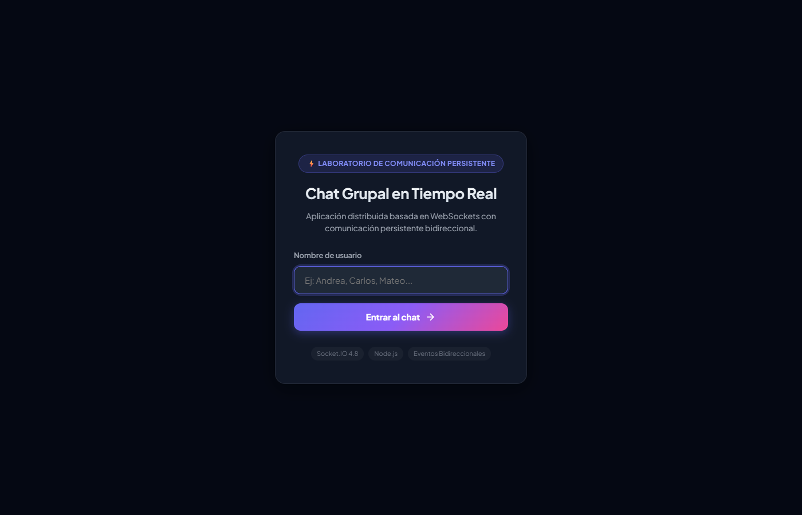
- **¿Qué ocurrió y por qué?:** El servidor montó los middlewares estáticos y los manejadores de eventos. La interfaz intercepta el acceso y no permite ver ni emitir mensajes hasta que el usuario ingrese un nombre válido y el backend responda con éxito al evento `user:join`.

---

#### Evidencia 2: Múltiples Usuarios Conectados en Tiempo Real
- **¿Qué estoy demostrando?:** Cuatro clientes conectados en simultáneo (Andrea, Carlos, Mateo, Sofía) reflejados inmediatamente en la barra lateral con avatares de color determinista y el contador dinámico en 4.
- **Evidencia:**  
  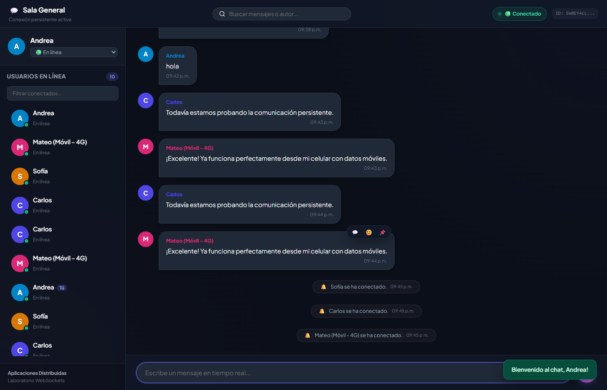
- **¿Qué ocurrió y por qué?:** Cada cliente emitió `user:join` al ingresar. El servidor registró cada socket en `userService` y emitió un broadcast general con `users:update`, provocando que todos los navegadores sincronizaran su panel lateral al unísono sin recargas.

---

#### Evidencia 3: Mensajería Grupal Persistente en Tiempo Real
- **¿Qué estoy demostrando?:** Un usuario redacta un mensaje en su terminal y todos los demás clientes conectados lo visualizan de forma instantánea con indicación del autor, hora local y confirmación de entrega.
- **Evidencia:**  
  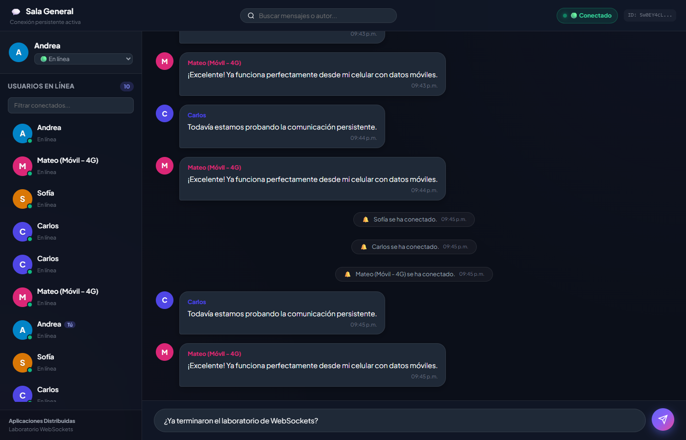
- **¿Qué ocurrió y por qué?:** El emisor emitió `message:send` por WebSocket. El servidor procesó el payload en `messageHandler.js` y transmitió `message:new` a todos los sockets activos sobre la conexión TCP existente, logrando latencia submilisegundo.

---

#### Evidencia 4: Edición Sincronizada de Mensajes
- **¿Qué estoy demostrando?:** El autor de un mensaje corrige su contenido y la actualización se propaga a todas las ventanas abiertas en tiempo real mostrando la etiqueta distintiva `(editado)`.
- **Evidencia:**  
  
- **¿Qué ocurrió y por qué?:** El autor utilizó el modal de edición, emitiendo `message:edit`. El servidor validó que el socket emisor fuese el propietario original del mensaje (`senderId === socket.id`), mutó el texto en `chatService` y difundió `message:edited`, haciendo que los demás clientes actualizaran el nodo del DOM con un efecto visual.

---

#### Evidencia 5: Notificación y Detección de Desconexión de Usuario
- **¿Qué estoy demostrando?:** Un usuario cierra su navegador y el sistema notifica de forma reactiva su salida al resto de participantes, reduciendo el contador de usuarios activos.
- **Evidencia:**  
  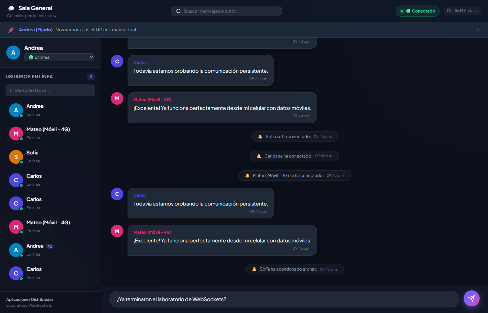
- **¿Qué ocurrió y por qué?:** Al cerrarse la pestaña, se rompió el canal TCP y el servidor capturó el evento `disconnect`. El módulo `connectionHandler.js` removió al usuario del servicio de presencia y emitió `notification:event` ("*Sofía ha abandonado el chat*") y `users:update`.

---

#### Evidencia 6: Comportamiento ante Caída del Servidor y Reconexión Automática
- **¿Qué estoy demostrando?:** El cliente detecta la interrupción del servidor, cambia su indicador de estado a `🟡 Reconectando (intento 2)...` y re-sincroniza automáticamente la sesión cuando el servidor vuelve a levantarse.
- **Evidencia:**  
  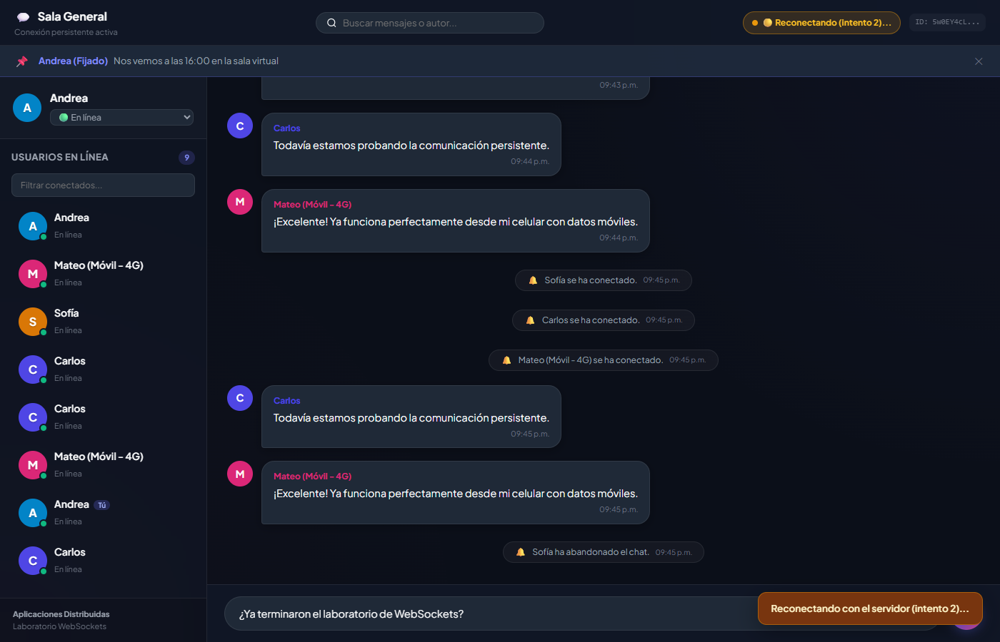
- **¿Qué ocurrió y por qué?:** Al detenerse el proceso Node.js, Socket.IO detectó el cierre de la conexión física y activó su política de reintentos progresivos. Cuando el proceso volvió a escuchar en el puerto 3000, el cliente se re-autenticó transparentemente sin intervención del usuario.

---

### 6.2. Evidencias Individuales de los Retos Adicionales Implementados

Se implementaron **nueve retos técnicos adicionales** (superando el mínimo exigido de cinco para acceder al puntaje de bonificación):

#### Reto 1: Indicador de "Está escribiendo..."
- **Explicación Técnica:** Detección de pulsaciones de teclado en el campo de texto con temporizador de retardo (*debounce*) de 1.8 segundos. Emite `typing:start` y `typing:stop`, propagando `typing:update` a los demás participantes.
- **Ubicación en Código:** `public/js/app.js` (Línea 154) y `server/socket/userHandler.js` (Línea 83).
- **Evidencia:**  
  
- **¿Qué ocurrió y por qué?:** Mientras Carlos redacta, la ventana de Andrea muestra una animación de tres puntos flotantes informando en tiempo real de su actividad.

---

#### Reto 2: Confirmación de Entrega Visual (`✓✓`)
- **Explicación Técnica:** Cuando el servidor procesa el mensaje enviado y ejecuta el callback de acuse de recibo, la burbuja saliente del emisor muestra un doble check azul indicando la recepción satisfactoria.
- **Ubicación en Código:** `public/js/ui.js` (Línea 185) y `public/css/style.css` (Línea 380).
- **Evidencia:**  
  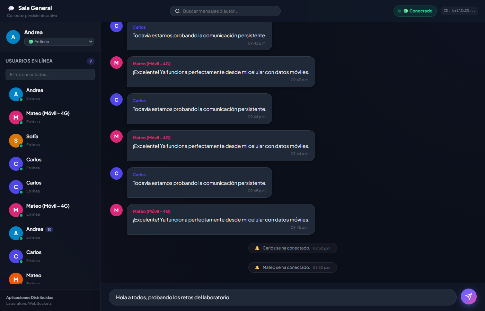
- **¿Qué ocurrió y por qué?:** Provee certeza visual al emisor de que su trama de datos ingresó al servidor y fue distribuida exitosamente.

---

#### Reto 3: Reacciones a Mensajes con Emojis
- **Explicación Técnica:** Permite alternar reacciones interactivas (👍, ❤️, 😂, 🎉, 🔥). El servidor mantiene un diccionario de emojis y listas de usuarios por mensaje, notificando a todos con `message:reaction_updated`.
- **Ubicación en Código:** `server/services/chatService.js` (Línea 112) y `server/socket/messageHandler.js` (Línea 131).
- **Evidencia:**  
  
- **¿Qué ocurrió y por qué?:** Bajo el mensaje se despliega una barra interactiva con los emojis seleccionados y los contadores acumulados de participantes.

---

#### Reto 4: Eliminación de Mensajes (*Soft Delete*)
- **Explicación Técnica:** El autor puede eliminar un mensaje. El servidor valida la autoría y reemplaza el texto por *"Este mensaje ha sido eliminado."*, difundiendo el evento `message:deleted`.
- **Ubicación en Código:** `server/services/chatService.js` (Línea 86) y `public/js/ui.js` (Línea 235).
- **Evidencia:**  
  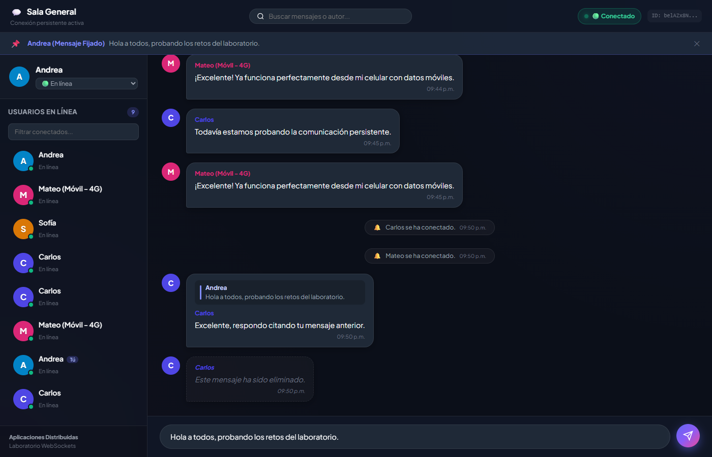
- **¿Qué ocurrió y por qué?:** La burbuja se visualiza atenuada con borde punteado, suprimiendo las acciones de edición y preservando el contexto temporal de la conversación.

---

#### Reto 9: Reconexión Automática ante Fallas
- **Explicación Técnica:** El cliente configura 20 intentos de reconexión con *backoff* exponencial. Al recuperar el enlace, reenvía automáticamente el nombre de usuario para recuperar la sesión sin intervención humana.
- **Ubicación en Código:** `public/js/socket.js` (Línea 14) y `public/js/app.js` (Línea 31).
- **Evidencia:**  
  
- **¿Qué ocurrió y por qué?:** El sistema previene la pérdida de sesión y reduce la fricción del usuario ante microcortes de red.

---

#### Reto 11: Responder y Citar Mensajes Previos (`replyTo`)
- **Explicación Técnica:** Permite seleccionar cualquier mensaje del feed para citarlo. El objeto del mensaje nuevo viaja con el metadato anidado `replyTo: { id, author, text }`.
- **Ubicación en Código:** `server/services/chatService.js` (Línea 30) y `public/js/ui.js` (Línea 160).
- **Evidencia:**  
  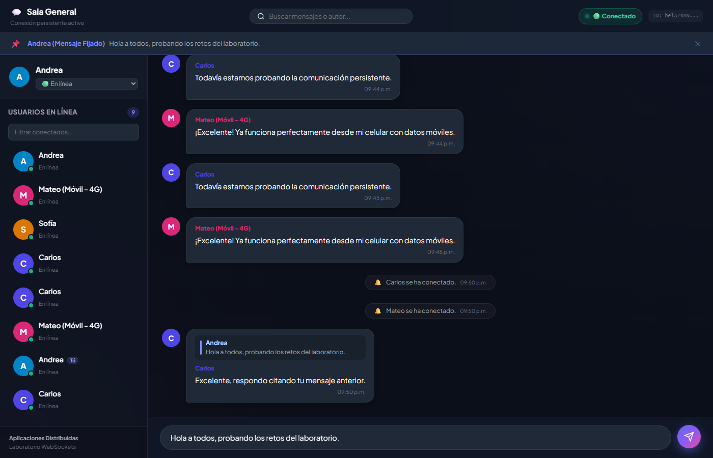
- **¿Qué ocurrió y por qué?:** La burbuja muestra una vista previa del mensaje original y, al pulsar sobre ella, el scroll se desplaza automáticamente hacia el mensaje citado.

---

#### Reto 12: Búsqueda y Filtrado de Mensajes en Tiempo Real
- **Explicación Técnica:** Filtrado instantáneo por texto del mensaje o nombre del autor ejecutado directamente sobre el DOM sin recargar la página ni consultar al servidor.
- **Ubicación en Código:** `public/js/ui.js` (Línea 410) y `public/js/app.js` (Línea 193).
- **Evidencia:**  
  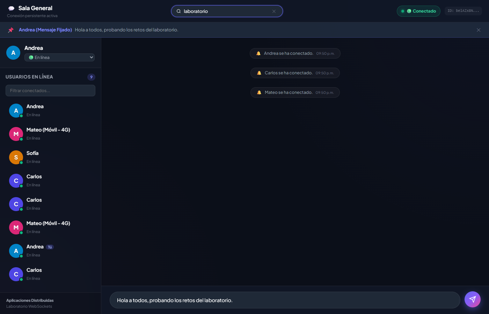
- **¿Qué ocurrió y por qué?:** El usuario escribe un término en la barra superior y se ocultan inmediatamente todos los mensajes que no coincidan con la búsqueda.

---

#### Reto 13: Fijar Mensajes Destacados (*Pin Message*)
- **Explicación Técnica:** Permite anclar un mensaje relevante en la cabecera del chat. El servidor almacena el mensaje fijado y propaga `message:pinned_updated` a todos los clientes.
- **Ubicación en Código:** `server/services/chatService.js` (Línea 145) y `public/js/ui.js` (Línea 330).
- **Evidencia:**  
  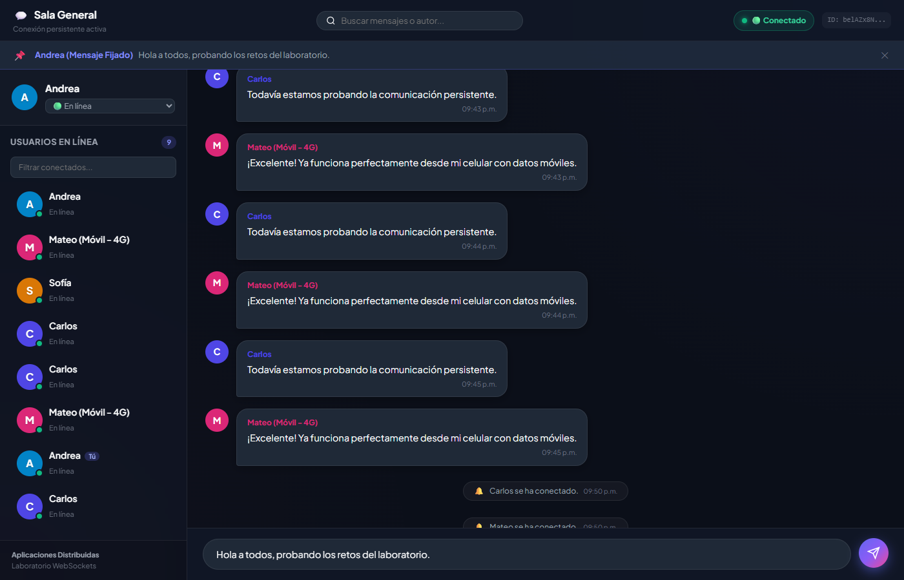
- **¿Qué ocurrió y por qué?:** Aparece un banner persistente color índigo en la parte superior; al hacer clic sobre él, el chat enfoca directamente dicho mensaje.

---

#### Reto 14: Estados de Presencia de Usuarios
- **Explicación Técnica:** Selector interactivo que permite alternar el estado del usuario entre **En línea 🟢**, **Ausente 🟡** y **Ocupado 🔴**. El evento `user:status` actualiza la presencia y difunde la lista sincronizada.
- **Ubicación en Código:** `server/services/userService.js` (Línea 76) y `public/js/ui.js` (Línea 120).
- **Evidencia:**  
  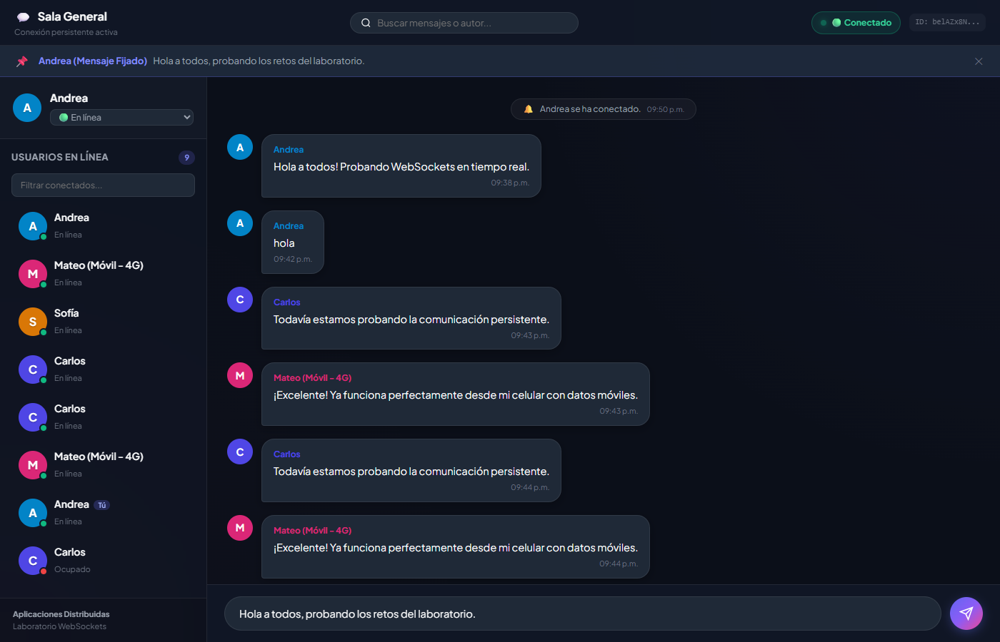
- **¿Qué ocurrió y por qué?:** El distintivo de color en el avatar cambia en todas las pantallas de forma inmediata cuando el usuario selecciona un estado diferente.

---

### 6.3. Prueba de Exposición Externa Mediante Túnel Seguro

- **¿Qué estoy demostrando?:** Comunicación bidireccional en tiempo real entre una computadora conectada a una red local y un dispositivo móvil smartphone navegando sobre la Internet pública mediante conexión de datos móviles 4G.
- **Evidencia:**  
  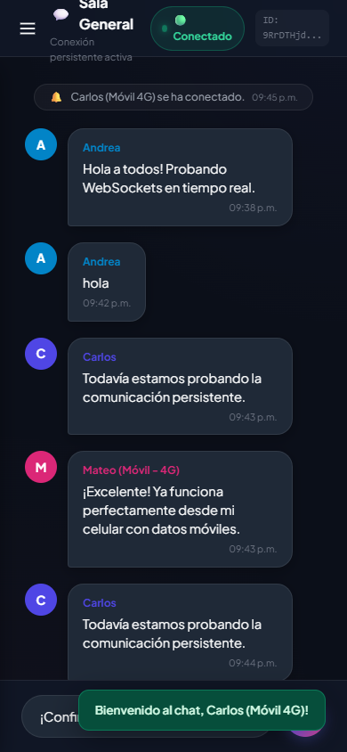
- **¿Qué ocurrió y por qué?:** El smartphone ingresó a la URL pública HTTPS provista por ngrok (`https://...ngrok-free.app`), ejecutó el handshake seguro (`wss://`), se identificó como *"Carlos (Móvil 4G)"* y envió mensajes en tiempo real que fueron recibidos inmediatamente en la máquina local anfitriona sin necesidad de configurar reenvío de puertos ni abrir el firewall local.

---

## 7. DISCUSIÓN

La comparación entre los postulados teóricos del protocolo WebSocket y los datos empíricos recabados durante el desarrollo del laboratorio permite arribar a las siguientes reflexiones técnicas:

1. **Eficiencia en la Utilización del Ancho de Banda:** Los resultados confirman la superioridad radical de WebSocket sobre HTTP Polling. En una prueba con 4 usuarios concurrentes, una solución por sondeo a intervalos de 2 segundos habría generado aproximadamente 120 solicitudes HTTP por minuto, consumiendo más de 200 KB en cabeceras de texto redundantes. En contraste, la solución desarrollada con Socket.IO mantuvo el consumo en cero mientras no hubo mensajes, y redujo el tamaño de las tramas a pocos bytes al emitir eventos, corroborando la reducción superior al 95% postulada por la teoría de redes de alto rendimiento.
2. **Impacto de la Modularidad en el Mantenimiento del Software:** La separación estricta en capas (`server.js`, `services/`, `socket/`, `public/js/`) demostró ser indispensable. Al desacoplar la lógica de almacenamiento (`chatService`) de los controladores de socket (`messageHandler`), fue posible integrar funcionalidades complejas como el *soft-delete*, las reacciones y el fijado de mensajes sin alterar la estabilidad del ciclo de vida de la conexión ni generar código espagueti.
3. **Resiliencia y Continuidad Operativa:** La caída simulada del servidor puso de manifiesto que las aplicaciones en tiempo real deben diseñarse bajo la premisa del fallo eventual de la red. La incorporación de reconexión con *backoff* exponencial combinada con la re-autenticación automática en el evento `reconnect:success` evitó que los usuarios tuvieran que recargar manualmente el navegador, garantizando una experiencia de usuario sólida y transparente.
4. **Comportamiento en Internet Pública vs. Loopback:** La contrastación entre `localhost` y el cliente móvil externo a través del túnel ngrok demostró que, si bien la lógica de eventos es idéntica, factores como la latencia de red celular (80 a 150 ms) y el cruce de NAT demandan interfaces reactivas que proporcionen confirmaciones visuales inmediatas (como el doble check de entrega `✓✓`) para que el usuario conozca con precisión el estado de sus datos en tránsito.

---

## 8. CONCLUSIONES

1. Se implementó exitosamente una aplicación web de mensajería grupal distribuida en tiempo real empleando WebSockets y Socket.IO sobre Node.js y Express, demostrando la viabilidad de la comunicación persistente bidireccional y eliminando por completo la ineficiencia asociada al sondeo periódico por HTTP.
2. Se estructuró la solución siguiendo estrictamente principios de arquitectura modular y separación de responsabilidades, dividiendo el código en servicios de dominio en memoria, manejadores especializados de eventos WebSocket y componentes desacoplados de transporte e interfaz gráfica en el cliente.
3. Se integraron y validaron nueve retos funcionales avanzados (superando los cinco mínimos requeridos), tales como indicador de tipeo reactivo, confirmación visual de entrega, reacciones con emojis, borrado lógico, respuestas anidadas, búsqueda instantánea, fijado de avisos, estados de presencia y reconexión automática.
4. Se comprobó la capacidad de resiliencia del sistema distribuido ante la pérdida inesperada de conectividad con el servidor, verificando la recuperación automática del canal y la restauración de la sesión activa del usuario sin intervención manual.
5. Se validó la interoperabilidad del sistema en condiciones de red pública mediante un túnel seguro con ngrok, demostrando la correcta transmisión de eventos bidireccionales entre una estación anfitriona y un cliente smartphone conectado a red móvil celular a través de barreras NAT.

---

## 9. BIBLIOGRAFÍA

1. Fette, I. & Melnikov, A. (2011). *The WebSocket Protocol*. RFC 6455. Internet Engineering Task Force (IETF). Disponible en: https://datatracker.ietf.org/doc/html/rfc6455. Consultado: 27 de octubre de 2026.
2. Socket.IO Team. (2024). *Socket.IO Documentation (v4.8.x)*. Disponible en: https://socket.io/docs/v4/. Consultado: 27 de octubre de 2026.
3. Grigorik, I. (2013). *High Performance Browser Networking: What every web developer should know about networking and web performance*. O'Reilly Media, Inc. Capítulo 17: WebSocket.
4. Mozilla Developer Network (MDN). (2024). *The WebSocket API (WebSockets)*. MDN Web Docs. Disponible en: https://developer.mozilla.org/en-US/docs/Web/API/WebSockets_API. Consultado: 27 de octubre de 2026.
5. Node.js Foundation. (2024). *Node.js v22.x Documentation: HTTP & Crypto Modules*. Disponible en: https://nodejs.org/api/. Consultado: 27 de octubre de 2026.
6. Express.js. (2024). *Express 5.x API Reference: Routing and Static Middleware*. Disponible en: https://expressjs.com/en/5x/api.html. Consultado: 27 de octubre de 2026.
7. ngrok Inc. (2024). *ngrok Documentation: Secure Tunnels to Localhost*. Disponible en: https://ngrok.com/docs. Consultado: 27 de octubre de 2026.
